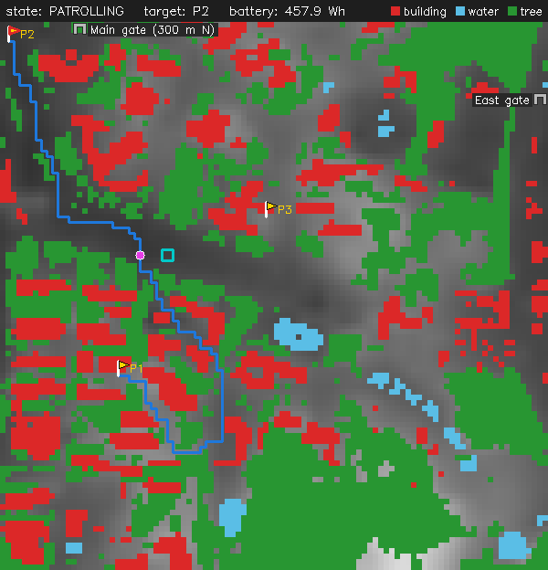
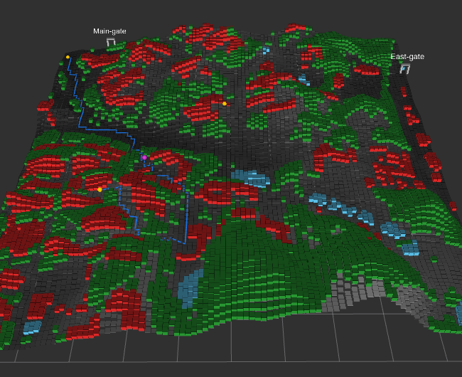

# 2.5D 지형 기반 UGV 순찰 경로 계획 제어기

[](https://github.com/jjaewon-Hong/UGV_Patrol_Planner/actions/workflows/ci.yml)
[](https://jjaewon-hong.github.io/UGV_Patrol_Planner/)


**[▶ 웹 데모 바로 열기](https://jjaewon-hong.github.io/UGV_Patrol_Planner/)** — 설치 없이 브라우저에서 순찰을 돌려 보고, 깃발·장애물을 직접 놓아 볼 수 있습니다.

고도가 있는 격자 지형에서 무인 지상 차량(UGV)의 순찰 경로를 계획하는 ROS 2 제어기입니다. 실제 차량 없이 시뮬레이션으로 검증하며, **영남대 경산캠퍼스 항공사진에서 딥러닝으로 장애물을 찾아 만든 지도**와 실제 고도 자료 위에서 순찰합니다.

| 2D 화면 (밝을수록 높음) | RViz2 (같은 순간, 높이 x5 증폭) |
|---|---|
|  |  |

캠퍼스 1 km × 1 km(10 m 칸). 빨강 건물, 초록 나무, 하늘색 물, 파란 선이 경로, 자홍색 점이 UGV, 하늘색 네모가 기지, 회색 아치가 정문·동문입니다.

## 기능

| 기능 | 내용 |
|---|---|
| 지형 경로 계획 | A\*로 장애물과 등판 한계(기본 30°, 캠퍼스 15°)를 넘는 경사를 피하고, 경사가 클수록 비용을 높인 최소 비용 경로 |
| 순찰 순서 | 가장 오래 방문하지 않은 지점부터 돌아 모든 지점을 고르게 감시 |
| 장애물 재계획 | 순찰 중 새 장애물이 경로를 막으면 0.5초 안에 새 경로 (실측 Python 48 ms, C++ 8 ms) |
| 배터리 복귀 | 기지까지 돌아갈 에너지가 부족해지기 전에 순찰을 멈추고 복귀 |
| 비정상 입력 처리 | 지도 밖 좌표, 갈 수 없는 목표에도 멈추지 않고 경보 |
| 실제 지역 지도 | 항공 정사영상 → 장애물 인식(PyTorch) + 실제 고도(DEM) → 캠퍼스 순찰 지도 |
| 두 가지 제어기 | Python(rclpy)과 C++17(rclcpp). 토픽·메시지가 같아 실행 인자 하나로 바꿔 끼움 |

센서, 배터리, 구동부는 ROS 2 시뮬레이션 노드로 대체하고, 결과는 OpenCV 2D 화면과 RViz2로 봅니다.

## 실행 (Ubuntu 24.04 + ROS 2 Jazzy)

```bash
bash scripts/setup_ros2_jazzy.sh   # 처음 한 번: ROS 2 설치
bash scripts/build.sh              # Python·C++ 패키지 빌드
bash scripts/run.sh campus cpp 5   # 지도(기본/low_battery/campus/campus_osm), 제어기(py/cpp), RViz 높이 배율
bash scripts/demo.sh campus        # 다른 터미널에서: 순찰 지점 등록 후 시작
bash scripts/ci.sh                 # 전체 시험 (CI와 같음)
```

ROS 2 없이 Docker로도 됩니다: `docker build -f scripts/Dockerfile -t ugv-patrol . && docker run --rm ugv-patrol`

**[웹 데모](https://jjaewon-hong.github.io/UGV_Patrol_Planner/).** C++ 핵심(`ugv_core`)을 그대로 WebAssembly로 빌드해 브라우저에서 순찰을 돌립니다. 깃발·장애물을 클릭으로 놓고, 배터리와 등판 한계를 슬라이더로 바꿉니다. push마다 GitHub Pages에 자동 배포되며, 로컬에서는 이렇게 빌드합니다.

```bash
bash scripts/setup_emsdk.sh        # 처음 한 번: Emscripten SDK 설치
bash scripts/build_web.sh          # web/ 에 WASM 모듈과 지도 생성
bash scripts/serve_web.sh          # http://localhost:8000
```

## 검증 결과

| 항목 | 결과 |
|---|---|
| 단위 시험 | Python 82개, C++(GoogleTest) 36개 통과 |
| 시나리오 시험 (실제 ROS 2 실행) | S1 정상 순찰, S2 장애물, S3 배터리 부족, S4 비정상 입력, S5 캠퍼스 순찰. 두 제어기 모두 통과 |
| 캠퍼스 순찰 (S5) | 깃발 3개 모두 방문, 장애물 진입 0회, 실제 이동 중 최대 경사 13.5° (한계 15°) |
| 장애물 인식 (직접 라벨 기준, 목표 0.6) | 건물+나무 IoU **0.63** (건물 0.75, 나무 0.56) |
| C++ vs Python A\* | 600개 경로가 칸 단위로 같음, C++가 약 20배 빠름 (평균 0.2 ms) |

## 구현 과정

1. **설계 먼저.** 요구사항(FR 22개, NFR 8개)과 아키텍처·유닛 5개(U1 지형, U2 A\*, U3 순찰 순서, U4 복귀 에너지, U5 임무 상태 기계)를 문서로 정한 뒤 Python으로 구현하고, 시험용 합성 지형에서 단위·시나리오 시험으로 확인했습니다.
2. **캠퍼스 지도 만들기.** 국토지리정보원 정사영상(25 cm)을 이어 붙여 자르고, OSM 건물 윤곽에 맞춰 위치를 13 m 보정했습니다. 장애물은 LoveDA로 학습한 DeepLabV3(mIoU 0.511)로 찾아 10 m 격자로 줄였습니다.
   ```
   정사영상 → 자르기 → 좌표 보정(OSM) → 장애물 인식(DeepLabV3) → 장애물 격자 ┐
   DEM(고도) → 같은 10 m 격자로 보간 ─────────────────────────→ 고도 격자   ┴→ ROS 2 제어기
   ```
3. **정답 데이터 직접 만들기.** OSM을 정답으로 쓰니 IoU가 0.44였는데, 원인은 OSM에 가로수·작은 숲과 일부 건물이 빠진 것이었습니다. 그래서 라벨링 도구(`tools/label_tool.py`)를 만들어 캠퍼스 중앙 200 m × 200 m를 모델 결과를 가린 채 직접 칠했고, 이 기준으로 IoU 0.63을 얻었습니다(같은 영역에서 OSM은 0.25). [비교 그림](docs/images/label_compare.png)
4. **실제 고도와 등판 한계.** Copernicus GLO-30(약 30 m 간격)을 10 m 칸으로 보간했습니다. 원본이 거칠어 30°로는 캠퍼스에서 막히는 이동이 0곳이라 경사 판단이 시험되지 않았고, 소형 바퀴형 UGV 기준인 15°로 정했습니다(막히는 이동 46곳).
5. **C++ 포팅.** U1\~U5와 제어기 노드를 C++17로 옮기고, 이웃 순서·동점 처리를 Python과 똑같이 맞춰 `tools/compare_cpp.py`로 경로가 같은지 확인했습니다. Docker 이미지와 GitHub Actions로 push마다 두 제어기를 모두 시험합니다.
6. **ROS 2 QoS.** 경로·상태처럼 마지막 값만 의미 있는 토픽은 Transient Local로 늦게 켠 노드도 바로 받게 하고, 명령·경보·장애물 보고는 Reliable로 빠지지 않게 했습니다.

요구사항, 설계, 시험 기준은 직접 정의했고 구현에는 AI 코딩 도구(Claude Code)를 활용했습니다. 시험 중 찾은 성능 문제(재계획 지연)와 버그는 원인을 분석해 고쳤습니다.

## 폴더 구성

| 폴더 | 내용 |
|---|---|
| `ugv_patrol_planner/` | Python 패키지: 유닛 U1~U5와 ROS 2 노드 |
| `cpp/` | C++17 핵심(`ugv_core`), rclcpp 제어기 노드, 웹용 시뮬레이션 |
| `share/` | 실행 자료: 설정, 시나리오, launch, RViz 설정, 지도 데이터 |
| `web/` | 웹 데모 페이지 |
| `tools/`, `scripts/` | 지도 제작 도구와 노트북 / 빌드·실행·시험 스크립트, Dockerfile |
| `test/`, `docs/` | Python 시험 / 리포트, 그림, 웹 데모 계획 |

## 데이터 출처

- 항공 정사영상: 국토지리정보원 국토정보플랫폼 (원본은 저장소에 넣지 않음, `tools/prepare_ortho.py`로 준비)
- 고도: Copernicus GLO-30 DEM. © DLR e.V. 2010-2014 and © Airbus Defence and Space GmbH 2014-2018, provided under COPERNICUS by the European Union and ESA
- 건물·물·숲 윤곽: © OpenStreetMap contributors (ODbL)
- 학습 데이터: LoveDA (Wang et al., NeurIPS 2021)

## 문서

- [docs/report1.md](docs/report1.md) — 프로젝트 관리 (범위, 규모 산정, WBS)
- [docs/report2.md](docs/report2.md) — 요구사항 (FR·NFR, 검증 방법)
- [docs/report3.md](docs/report3.md) — 설계 (아키텍처, UML, 유닛 상세 설계)
