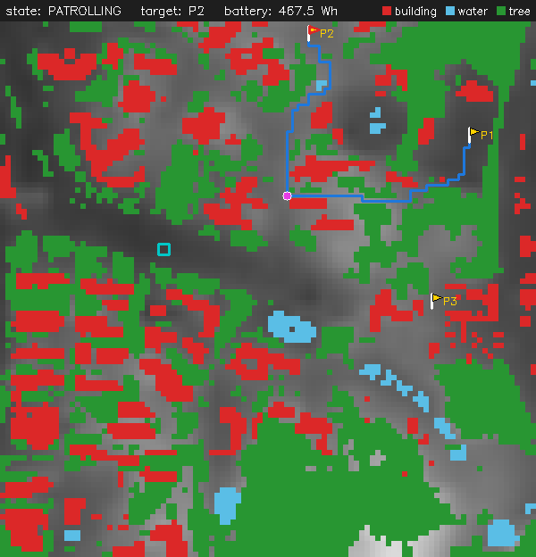
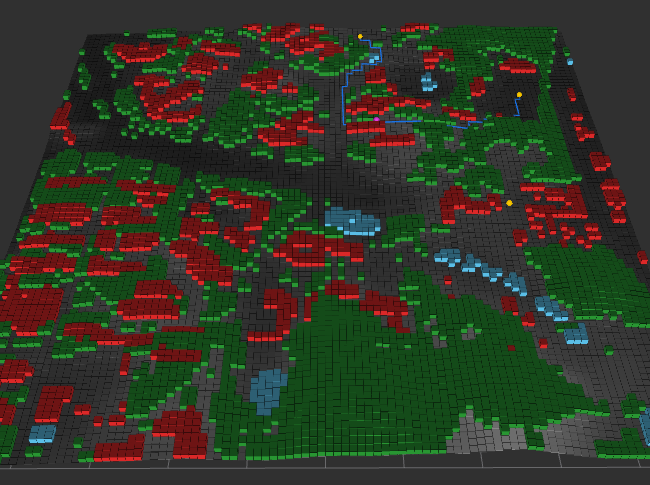
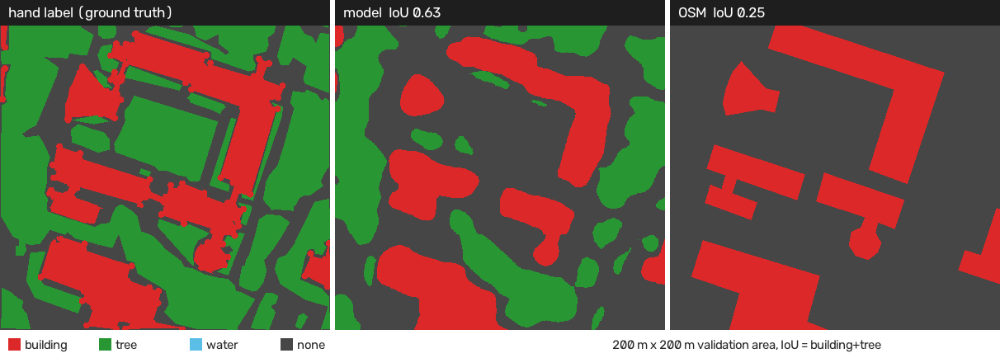

# 2.5D 지형 기반 UGV 순찰 경로 계획 제어기

[](https://github.com/jjaewon-Hong/ugv_patrol_planner/actions/workflows/ci.yml)


고도 정보가 있는 격자 지형에서 무인 지상 차량(UGV)의 순찰 경로를 계획하는 제어기를, 실제 차량 없이 ROS 2 시뮬레이션으로 검증하는 소프트웨어공학 프로젝트입니다. 시험용 지형에서 검증한 뒤, **실제 지역(영남대 경산캠퍼스)의 항공 정사영상에서 장애물을 인식해 만든 지도**로 순찰하도록 확장했습니다. 제어기는 Python(rclpy)과 C++17(rclcpp) 두 가지로 구현했고, 같은 시험을 둘 다 통과하는지 CI에서 자동으로 확인합니다.

```
항공 정사영상 → 이어 붙이기·자르기 → 좌표 보정(OSM) → 장애물 인식(PyTorch 분할 모델) → 장애물 격자 ┐
DEM(고도)     → 같은 10 m 격자로 리샘플링 ──────────────────────────────────────────→ 고도 격자   ┴→ ROS 2 순찰 제어기 (A*, 재계획, 기지 복귀)
```

### 실행 화면

캠퍼스 지도(1 km × 1 km, 10 m 칸)에서 C++ 제어기로 순찰하는 장면입니다(`bash scripts/run.sh campus cpp` → `bash scripts/demo.sh campus`). 장애물은 분할 모델이 정사영상에서 찾은 건물(빨강), 나무(초록), 물(하늘색)입니다. 파란 선은 경사를 반영한 A\* 경로, 자홍색 점은 UGV, 하늘색 네모는 기지입니다. UGV는 P1을 들른 뒤 P2로 가는 중입니다.

| 2D 화면 (위에서 본 지도, 회색이 밝을수록 높음) | RViz2 (같은 순간을 3D로, 실제 고도 비율) |
|---|---|
|  |  |

## 진행 현황

| 단계 | 내용 | 상태 |
|---|---|---|
| 1 | 요구사항·설계 (report1\~3), 핵심 유닛 U1\~U5, ROS 2 노드, 단위·시나리오 시험 | 완료 |
| 2 | 캠퍼스 정사영상 확보, 이어 붙이기·자르기 (`tools/prepare_ortho.py`) | 완료 |
| 3 | 장애물 인식: PyTorch DeepLabV3를 LoveDA로 학습해 캠퍼스 추론 (`notebooks/`), 직접 라벨링한 검증 영역과 OSM으로 IoU 평가 (`tools/label_tool.py`, `tools/campus_map.py`) | 완료 (직접 라벨 기준 NFR-08 충족) |
| 4 | 좌표 보정, 고도 데이터 정합, 깃발 무작위 배치, 캠퍼스 시나리오 S5 | 완료 (`campus`: 모델 지도, `campus_osm`: OSM 지도) |
| 5 | 핵심 알고리즘 C++17 포팅 (`cpp/`), Docker·GitHub Actions 자동 시험 | 완료 |
| 6 | C++ ROS 2 제어기 노드 (rclcpp, U1\~U5 전부 C++) | 완료 (`controller:=cpp`) |

## 무엇을 시험하나

| 시험 | 확인하는 것 |
|---|---|
| 지형 경로 계획 | 등판 한계(30°)를 넘는 경사와 장애물을 피하는 최소 비용 경로를 A\*로 만드는가 |
| 순찰 순서 | 가장 오래 방문하지 않은 지점을 먼저 가서 모든 지점을 고르게 감시하는가 |
| 장애물 재계획 | 순찰 중 경로 위에 새 장애물이 나타나면 0.5초 안에 새 경로를 만드는가 |
| 배터리 복귀 | 복귀에 필요한 에너지가 부족해지기 전에 순찰을 멈추고 기지로 돌아오는가 |
| 비정상 입력 | 지도 밖 좌표나 갈 수 없는 목표에도 멈추지 않고 경보를 내는가 |

인식 센서, 배터리, 구동부는 ROS 2 시뮬레이션 노드로 대체하고, 결과는 OpenCV 화면과 RViz2로 확인합니다.

## 구성: Python, C++, ROS 2

| 구분 | 맡은 일 | 위치 |
|---|---|---|
| ROS 2 | 노드 사이 통신(토픽·QoS), 실행(launch), 표시(RViz2). 언어가 달라도 같은 토픽으로 통신 | `launch/`, `rviz/` |
| Python | 제어기(rclpy), 시뮬레이터(구동·배터리·인식), 2D 화면, 데이터 처리, 딥러닝, 시험 | `ugv_patrol_planner/`, `tools/`, `notebooks/`, `test/` |
| C++17 | 제어기(rclcpp)와 핵심 유닛 U1\~U5 전부. Python 제어기와 토픽·메시지·QoS·상태 JSON이 같아 그대로 바꿔 끼울 수 있음 | `cpp/` (패키지 `ugv_patrol_planner_cpp`) |

```
[제어기: Python 또는 C++]  ←→  ROS 2 토픽  ←→  [구동·배터리·인식 시뮬레이터, 2D 화면, RViz2: Python]
```

## 실행 방법 (Ubuntu 24.04 + ROS 2 Jazzy, WSL2)

```bash
bash scripts/setup_ros2_jazzy.sh     # 처음 한 번: ROS 2 설치
bash scripts/build.sh                # ~/ros2_ws에 Python·C++ 두 패키지 빌드
bash scripts/run.sh                  # 제어기 + 시뮬레이션 + 2D 화면 + RViz2 실행 (run.sh low_battery, run.sh campus, run.sh campus_osm)
bash scripts/run.sh campus cpp       # C++ 제어기로 실행 (두 번째 인자: py 또는 cpp)
bash scripts/demo.sh                 # 다른 터미널에서: 순찰 지점 등록 후 시작 (run.sh와 같은 이름, 예: demo.sh campus)
python3 -m pytest                    # 단위 시험 70개 (ROS 2 없이도 실행 가능)
source ~/ros2_ws/install/setup.bash && python3 scripts/scenario_test.py   # 시나리오 시험 S1~S5 (--cpp: C++ 제어기)
bash scripts/ci.sh                   # CI와 같은 전체 시험 (Python, C++, C++ vs Python, 시나리오 × 두 제어기)
```

RViz2 카메라와 격자는 실행할 때 지도 크기(칸 수 × 칸 크기)에 맞춰 잡힙니다. 그래서 3 km 기본 지도와 1 km 캠퍼스 지도 모두 화면 가운데에 꽉 차게 보입니다(`ugv_patrol_planner/rviz_view.py`). `rviz/patrol.rviz`는 그 틀로 쓰는 원본입니다. 캠퍼스 지도에서는 장애물을 종류별 색으로 표시합니다. 건물은 빨강, 나무는 초록, 물은 하늘색입니다. 이 정보는 `obstacle_classes.npy`에서 읽으며, 화면 표시에만 쓰고 경로 계획에는 쓰지 않습니다. 종류를 모르는 장애물은 빨강으로 표시합니다. 시험용 지도의 장애물과 센서로 새로 찾은 장애물이 여기에 해당합니다. UGV는 나무와 구분되도록 자홍색으로 표시합니다.

Docker로 실행하면 ROS 2를 설치하지 않아도 됩니다. GitHub Actions도 push마다 같은 이미지로 전체 시험을 돌립니다.

```bash
docker build -t ugv-patrol . && docker run --rm ugv-patrol
```

기본 지형은 `tools/make_synthetic_dem.py`로 만든 시험용 지도(언덕 + 30°를 넘는 절벽)이고, `campus`는 영남대 캠퍼스 1 km × 1 km를 10 m 칸 100×100으로 만든 지도입니다. 캠퍼스에서는 기지에서 갈 수 있는 빈 칸에 깃발 3개를 시드로 무작위 배치합니다.

## 데이터

| 데이터 | 출처 | 비고 |
|---|---|---|
| 항공 정사영상 (2025, 25 cm, 도엽 35804061·35804071) | 국토지리정보원 국토정보플랫폼 | 원본은 용량과 이용 조건 때문에 저장소에 넣지 않음. `tools/prepare_ortho.py`로 캠퍼스 1.02 km × 1.53 km를 잘라 사용 |
| 고도 (Copernicus GLO-30 DEM) | © DLR e.V. 2010-2014 and © Airbus Defence and Space GmbH 2014-2018, provided under COPERNICUS by the European Union and ESA | 캠퍼스 범위를 10 m 격자로 리샘플링해 `data/campus_osm/dem.npy`에 포함 (`tools/campus_world.py`) |
| 건물·물·숲 윤곽 | © OpenStreetMap contributors (ODbL) | 좌표 보정과 정답 지도에 사용, 10 m 장애물 격자를 `data/campus_osm/obstacles.npy`에 포함 (`tools/osm_mask.py`) |
| 학습 데이터 (LoveDA) | Wang et al., NeurIPS 2021, Zenodo 5706578 | Kaggle 노트북에서 내려받아 학습에만 사용 |
| 시험용 지형 | `tools/make_synthetic_dem.py` | 저장소의 `data/`에 포함 |

## 검증 결과

| 항목 | 결과 |
|---|---|
| 단위 시험 (U1\~U5, 깃발 배치, 좌표 변환, 라벨링 도구, RViz 시점, 장애물 종류) | 70개 통과 |
| 시나리오 시험 (실제 ROS 2 실행) | S1 정상 순찰, S2 장애물 발견, S3 배터리 부족, S4 비정상 입력, S5 캠퍼스 순찰을 Python·C++ 제어기 모두 통과 |
| 정사영상 좌표 보정 | 도엽 번호로 위치를 계산한 뒤 OSM 건물 윤곽에 맞춰 13 m 보정 |
| 분할 모델 학습 (LoveDA 검증 세트) | mIoU 0.511 (15에폭, Kaggle T4 2시간 18분), 건물 0.63, 물 0.69, 숲 0.38 |
| 캠퍼스 인식 vs 직접 라벨 (NFR-08, 기준 0.6) | 200 m × 200 m 검증 영역: 건물+나무 IoU **0.63 (충족)**, 건물 0.75, 나무 0.56 |
| 같은 영역에서 OSM vs 직접 라벨 | 건물+나무 IoU 0.25, 건물 0.50, 나무 0 (OSM에 가로수·작은 숲 없음) |
| 캠퍼스 전체 인식 vs OSM (참고) | 건물+숲 IoU 0.44 (OSM이 불완전해 정답으로 쓰기 어려움, 아래 분석) |
| 캠퍼스 모델 지도 순찰 (S5) | 장애물 칸 48 %, 깃발 3개 모두 방문, 장애물 칸 진입 0회 |
| 재계획 지연 (S2, 장애물 보고 → 새 경로 발행) | Python 제어기 최대 48 ms, C++ 제어기 최대 8 ms (요구사항 0.5초 이내) |
| C++ A\* vs Python A\* (지도 3종 × 200쌍) | 600개 경로가 칸 단위로 모두 같음, 비용 차이 5×10⁻¹⁰ 이하 |
| C++ A\* 속도 | 평균 0.15\~0.24 ms, 최대 1.0 ms (Python 2.8\~5.6 ms, 최대 32 ms) → 약 20배 |
| C++ 단위 시험 (GoogleTest) | 23개 통과 (U1\~U5: Dijkstra 기준 최적성, 등판 한계, 복귀 에너지, 순찰 순서, 임무 상태 전이, 상태 JSON 형식) |

### 직접 라벨링한 정답 데이터로 검증

모델은 공개 데이터셋 LoveDA로 학습했고, 캠퍼스에서 얼마나 정확한지는 직접 만든 정답 데이터로 채점했습니다.

- **왜:** 처음에는 OSM을 정답으로 썼지만 IoU가 0.44로 낮게 나왔습니다. 원인을 나눠 보니 OSM 자체가 불완전했습니다(가로수와 작은 숲이 없고, 빠진 건물이 있음. `tools/campus_map.py eval`). 불완전한 정답으로는 모델을 공정하게 채점할 수 없습니다. 그래서 계획 문서(report2·3)의 NFR-08에서 정답 지도로 정한 OSM을, 실제 시험에서는 직접 만든 라벨로 바꿨습니다.
- **무엇을:** 캠퍼스 중앙 200 m × 200 m를 25 cm 해상도로 직접 칠해 건물, 나무, 물 정답 지도를 만들었습니다. 이를 위해 라벨링 도구(`tools/label_tool.py`)를 따로 만들었습니다. 붓과 다각형 채우기, 되돌리기를 지원하고, 동작은 단위 시험으로 확인합니다.
- **어떻게:** 라벨링하는 동안 모델 결과와 OSM을 화면에서 가려, 모델에 유리하게 칠하는 편향을 막았습니다. 정답 지도에서 건물은 24 %, 나무는 49 %를 차지합니다.
- **결과:** 같은 영역에서 모델은 건물+나무 IoU **0.63**으로 목표(NFR-08, 0.6)를 넘었고, OSM은 0.25에 그쳤습니다. OSM보다 모델이 실제에 더 가깝다는 결론과, 남은 약점(나무가 듬성듬성한 안뜰 정원을 나무로 보지 않음)을 이 정답 데이터로 확인했습니다.



OSM 기준 점수가 낮았던 원인:
- **정답 지도(OSM)가 불완전함:** 모델이 찾은 숲의 48 %는 가로수·작은 숲으로 OSM에 없고, 모델이 찾은 건물의 49 %도 OSM에 없는 곳(누락 건물, 지붕 가장자리)입니다. OSM 숲 안의 27 %는 실제로는 풀밭·빈터입니다.
- **학습 데이터와 지역 차이:** LoveDA는 중국 도시 영상이라, OSM 건물 면적 중 모델이 찾은 비율(재현율)은 0.58에 그칩니다.
- **남은 위치 오차:** 예측과 OSM 건물 사이에 약 7 m 어긋남이 남아 있으며, 보정하면 건물 IoU가 0.37에서 0.40으로 오릅니다.

다음 단계: 검증 영역을 여러 곳으로 늘려 결과의 신뢰도를 높이고, 국내 항공영상 데이터로 미세 조정합니다.

## C++17 제어기 (`cpp/`)

- **`ugv_core` 라이브러리 (ROS 의존 없음):** U1 지형, U2 A\*, U3 순찰 순서, U4 복귀 에너지 지도, U5 임무 상태 기계. Python 버전처럼 U5는 ROS를 직접 부르지 않고 출력 목록(다음 칸, 경로, 상태, 경보)만 돌려줍니다.
- **`controller` 노드 (rclcpp):** 설정 YAML(yaml-cpp)과 지도(.npy)를 읽고, Python 제어기와 같은 토픽·메시지·QoS로 통신합니다. 상태 JSON 형식까지 같아서 Python 시뮬레이터·화면·시나리오 시험을 그대로 씁니다.
- **같은 결과 보장:** 이웃 순서와 동점 처리 규칙(f, h, 삽입 순서)을 Python과 똑같이 맞췄습니다. `tools/compare_cpp.py`가 같은 지도·같은 출발/도착 쌍으로 두 구현을 돌려 경로가 칸 단위로 같은지 확인합니다.
- **속도:** 칸 좌표 대신 정수 인덱스와 연속 배열(`std::vector`)을 쓰고, 4방향 이동 비용을 미리 계산해 탐색 중에는 조회만 합니다.
- **빌드:** CMake + GoogleTest, `-Wall -Wextra -Wpedantic -Werror`.

```bash
cmake -S cpp -B build_cpp && cmake --build build_cpp -j && (cd build_cpp && ctest)   # ROS 없이 라이브러리·시험만
echo "0 0 99 99" | build_cpp/ugv_plan data/dem_100x100.npy - 30    # 비용, 계획 시간, 경로 출력
```

## ROS 2 통신과 DDS QoS

| 토픽 | 메시지 | QoS | 이유 |
|---|---|---|---|
| `/controller/path`, `/mission/status`, `/viz/markers` | Path, String(JSON), MarkerArray | Reliable + **Transient Local**, depth 1 | 상태성 데이터라 마지막 값만 의미가 있음. 늦게 켠 화면·RViz2·시험 노드도 접속 즉시 현재 경로와 상태를 받음 |
| `/operator/command`, `/mission/alarm` | String | Reliable, Volatile, depth 10 | 명령·경보는 하나도 빠지면 안 되고, 지난 명령을 나중에 다시 받으면 안 됨 |
| `/perception/obstacles` | PoseArray (헤더 시각 포함) | Reliable, depth 10 | 장애물 보고를 놓치면 충돌 위험. 헤더 시각으로 재계획 지연(0.5초)을 측정 |
| `/ugv/pose`, `/battery/level`, `/controller/next_cell` | Point, Float32 | Reliable, depth 10 | 시뮬레이션에서는 시험 결과가 매번 같도록 Reliable 사용 |

- 실제 센서를 붙이면 `/ugv/pose`, `/battery/level`처럼 주기가 빠르고 최신 값만 중요한 토픽은 **Best Effort**가 맞습니다. 이때 구독자가 Reliable이면 발행자(Best Effort)와 QoS가 맞지 않아 메시지를 받지 못하므로, 구독 쪽도 함께 바꿔야 합니다.
- 시나리오 시험은 `ROS_DOMAIN_ID=77`로 따로 돌려, 같은 PC에서 데모를 띄워 둬도 DDS 통신이 섞이지 않습니다.

## 개발 방식

요구사항, 설계(아키텍처·유닛 설계), 시험 기준은 직접 정의했고, 구현에는 AI 코딩 도구(Claude Code)를 활용했습니다. 모든 기능은 위의 단위 시험과 시나리오 시험으로 검증했으며, 시험 과정에서 발견한 성능 문제(재계획 지연)와 버그는 원인을 분석해 수정했습니다.

## 문서

- [report1.md](report1.md) — 과제1: 프로젝트 관리 (범위, 이해관계자, 규모 산정, WBS)
- [report2.md](report2.md) — 과제2: 요구사항 (FR 22개, NFR 8개, 변경 이력 v1.1, 검증 방법)
- [report3.md](report3.md) — 과제3: 설계 (아키텍처, UML, 유닛 5개 상세 설계, 구현 단계 설계 보완)
