# 2.5D 지형 기반 UGV 순찰 경로 계획 제어기

<p class="subtitle">소프트웨어공학 과제 통합 문서 — [과제1] 프로젝트 관리 · [과제2] 요구사항 · [과제3] 설계 · [과제4] 구현 및 시험</p>

| 구분 | 과제 | 내용 | 주요 산출물 |
|---|---|---|---|
| 제1부 | 과제1 | 프로젝트 관리 | 범위 정의, 시스템 문맥도, 이해관계자, 제약사항·위험(결과 포함), 규모 산정, WBS |
| 제2부 | 과제2 | 요구사항 작성 | 기능 요구사항 FR-01\~22, 비기능 요구사항 NFR-01\~08, 변경 이력, 검증 방법 |
| 제3부 | 과제3 | 설계 | 아키텍처 모델(계층·MVC·파이프-필터), DFD·구조도, UML, 토픽 인터페이스, 유닛 구성 |
| 제4부 | 과제4 | 구현 및 시험 | 코드 구성, 유닛(객체) 설계 5개와 코드, 요구사항·설계·구현 대상 Test Case 21개, 추적표 |

# 제1부. 프로젝트 관리 [과제1]

범위 정의(Scope Definition), 이해관계자 및 대상 시스템 분석. 과제4 시점의 진행 결과(위험의 실제 결과, WBS 상태)를 함께 표시했다.

## 1. 대상 제어기와 프로젝트 목표

| 항목 | 내용 |
|---|---|
| 제어기 | UGV 순찰 경로 계획 제어기 (Patrol Path Planning Controller) |
| 역할 | 고도 정보가 있는 2.5D 격자 지형에서 순찰 지점의 방문 순서를 정하고, 각 지점까지의 경로를 A\*로 생성한다. 순찰 중 새 장애물이나 배터리 부족이 생기면 경로나 임무를 다시 계획한다. |
| 제어 계층 | 자율주행 UGV의 계획 구조(전역 경로계획 → 지역 경로계획 → 구동 제어) 중 전역 경로계획과 임무 관리 계층 |
| 선정 이유 | 지상 무인체계의 핵심인 경로계획을 하드웨어 없이 SILS(Software-in-the-Loop Simulation)로 검증할 수 있고, 인식·계획·임무 관리·구동을 ROS 2 노드로 나눠 실제 무인체계의 소프트웨어 구조를 경험할 수 있다. |

1. 2.5D 격자 지형에서 등판 한계를 넘는 경사를 피하는 순찰 경로를 생성한다.
2. 감시 공백이 가장 긴 지점을 우선 방문하여 순찰 지점 간 감시가 고르게 이루어지도록 한다.
3. 순찰 중 새 장애물이 감지되면 경로를 다시 계산한다.
4. 배터리가 부족해지면 순찰을 중단하고 기지로 복귀한다.
5. 인식·계획·임무 관리·구동·표시 기능을 ROS 2 노드로 분리하고, 노드 간 데이터를 토픽(발행-구독)으로 주고받는다.

## 2. 프로젝트 범위

| 구분 | 내용 |
|---|---|
| 지도 데이터 | 공개 DEM에서 구역을 잘라 N×N 격자 고도 지도(기본 100×100)로 사용. 장애물은 설정으로 추가 (v1.1부터 항공 정사영상 인식 결과도 사용) |
| 지형 경로 계획 | 4방향 A\*. 등판 한계를 넘는 경사는 통행 불가, 그 이하는 경사에 비례해 비용 증가 |
| 순찰 순서 결정 | 마지막 방문 이후 가장 오래 지난 지점을 다음 목표로 선정(최장 대기 우선) |
| 장애물 재계획 / 배터리 복귀 | 센서 범위 안 새 장애물이 경로를 막으면 재계산 / 복귀 에너지가 부족해지기 전에 기지로 복귀 |
| ROS 2 노드 구조 / 시각화 | 제어기와 시뮬레이션 요소(인식 센서, 배터리, 구동부)를 노드로 구현 / OpenCV 2D 화면과 RViz2 마커 |
| 선택 구현 | 지형 유형별 비용, 최근 지나간 칸 벌점, 통신 두절 시 정지, 목표 차단 시 건너뛰고 보고 |
| 제외 | 차량 동역학·모터 제어·지역 경로계획, 실제 센서·SLAM, 이동 물체 회피, 다중 UGV, 3차원 구조, Gazebo 연동 |

## 3. 시스템 문맥도 및 이해관계자

<figure>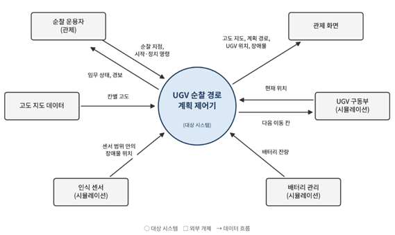<p class="cap">그림 1. UGV 순찰 경로 계획 제어기 시스템 문맥도 (○ 대상 시스템, □ 외부 개체, → 데이터 흐름)</p></figure>

| 외부 개체 | 제어기로 들어오는 데이터 | 제어기에서 나가는 데이터 |
|---|---|---|
| 순찰 운용자 (관제) | 순찰 지점 지정, 시작·정지 명령 | 임무 상태, 경보 |
| 고도 지도 데이터 | 칸별 고도 (시작 시 파일에서 읽음) | |
| 인식 센서 / 배터리 관리 (시뮬레이션) | 센서 범위 안의 장애물 위치 / 배터리 잔량 | |
| UGV 구동부 (시뮬레이션) | 현재 위치 | 다음 이동 칸 |
| 관제 화면 (OpenCV, RViz2) | | 고도 지도, 계획 경로, UGV 위치, 장애물 |

| 이해관계자 | 유형 | 역할 및 관심사 |
|---|---|---|
| 순찰 운용자 | 직접 사용자 | 순찰 지점 설정과 임무 시작·중지. 설정이 쉽고 이상 상황이 즉시 보고되는지 |
| 관제 지휘관 | 직접 사용자 | 순찰 상황 감시·판단. 모든 지점이 고르게 감시되는지 |
| 정비·개발자 | 간접 사용자 | 유지보수와 개선. 모듈 교체와 설정값 조정이 쉬운지 |
| 시험평가 담당자 | 간접 사용자 | 요구사항 충족 검증. 상황별 대응을 재현하고 확인할 수 있는지 |

## 4. 제약사항과 위험

| 구분 | 제약사항 (수치는 가정값이며 설정 파일로 조정) |
|---|---|
| 기동 성능 | 최대 등판각 30°를 넘는 경사는 통행 불가 (칸 30 m 기준 인접 칸 고도차 약 17 m) |
| 지도 규모 / 인식 | 기본 100×100 격자 / 센서는 UGV 주변 반경 3칸 안의 장애물만 감지 |
| 실시간성 / 에너지 | 새 장애물 감지 후 0.5초 이내 재계획 / 기지 복귀 에너지에 여유분 20% 확보 |
| 프로젝트 | 1인 개발, 2학기 종강 전까지. 실제 차량 없이 시뮬레이션으로만 검증. Windows 11 + WSL2(Ubuntu), ROS 2, Python. 무료 오픈소스만 사용 |

| No. | 위험 | 치명도 / 빈도 | 계획한 대응 | 실제 결과 (과제4 시점) |
|---|---|---|---|---|
| 1 | 구현 지연 | High / Mid | 필수 구현부터 진행, 선택 구현은 확장으로 | 필수 항목을 먼저 완료. 선택 구현 중 "목표 차단 시 건너뛰고 보고"만 구현(TC-R-04) |
| 2 | 비용 설정 오류로 비현실적 경로 | Mid / Mid | 가중치를 설정값으로 분리해 시험 | 캠퍼스에서 30°로는 막히는 이동이 없음을 발견, 설정 파일만 15°로 바꿔 해결(v1.3, TC-R-07) |
| 3 | ROS 2 환경 구축 지연 | Mid / Mid | 발행-구독 예제부터 확인, 안 되면 자체 메시지 버스 | WSL2 + ROS 2 Jazzy 설치 스크립트로 해결, 대체안 불필요. Docker 이미지로 환경을 재현해 CI에서도 사용 |

## 5. 프로젝트 규모 산정

**LOC 기법:** 추정 LOC = (낙관치 + 4 × 기대치 + 비관치) / 6. 구현 후 실제 줄 수와의 비교는 제4부 1.3절에 있다.

| 모듈 | 낙관치 | 기대치 | 비관치 | 추정 LOC |
|---|---|---|---|---|
| 지형 지도 및 비용 모델 | 70 | 110 | 170 | 113.3 |
| A\* 경로 계획 및 재계획 | 50 | 70 | 100 | 71.7 |
| 순찰·임무 관리 (순찰 순서, 배터리 복귀) | 60 | 90 | 130 | 91.7 |
| 시뮬레이션 노드 (인식·배터리·구동부) | 60 | 90 | 130 | 91.7 |
| ROS 2 노드 구성 및 토픽 인터페이스 (launch 포함) | 40 | 60 | 90 | 61.7 |
| 시각화 (OpenCV 화면, RViz2 마커) | 70 | 100 | 150 | 103.3 |
| **합계** | | | | **약 533 LOC** |

**기능점수(FP) 기법:** ILF 2(순찰 지점 정보, 장애물 지도), EIF 2(고도 지도, 배터리 상태), EI 4(지점 등록·수정, 시작·정지, 장애물 감지, 위치 입력), EO 4(순찰 경로, 이동 명령, 경보, 상황 지도), EQ 2(지점 상태, UGV 상태 조회)를 식별했다.

| 단계 | 계산 | 결과 |
|---|---|---|
| 미조정 기능점수 | ILF 2×7.5 + EIF 2×5.4 + EI 4×4.0 + EO 4×5.2 + EQ 2×3.9 | 70.4 FP |
| 보정 전 개발 원가 | 70.4 FP × 605,784원 (2024년 FP당 단가) | 42,647,194원 |
| 보정 후 개발 원가 | × 보정 계수 1.152 (규모 1.28, 연계 0.94, 성능 1.05, 호환성 0.94, 보안 0.97) | 49,126,667원 |
| 소프트웨어 개발비 | 보정 후 원가 + 이윤 25% + 직접 경비 0원 | **61,408,334원 (약 6,141만 원)** |

개발비는 외주·상용 개발을 가정한 참고값이다. 실제로는 직접 개발하고 도구가 모두 무료이므로 **실제 지출은 0원**이며, 일정은 작업별 상향식 추정(39시간)으로 관리했다.

## 6. 주요 업무 구분 및 WBS

1일 작업량은 4시간 기준이며 작업자는 모두 본인이다.

| 작업번호 | 작업 이름 | 기간(일) | 상태 | 연계 |
|---|---|---|---|---|
| **1** | **프로젝트 관리 및 요구 분석** (범위, 문맥도, 제약, 규모·일정) | **1.5** | 완료 (과제1·2) | 1부, 2부 |
| **2** | **설계** (모듈 구조·토픽 인터페이스, 비용 모델·상태 전환) | **1.0** | 완료 (과제3) | 3부 |
| 3.1 | 개발 환경 구축 (WSL2, ROS 2, RViz2) | 0.5 | 완료 | 1부 위험 3 |
| 3.2 | 지형 지도(DEM 전처리 포함) 및 비용 모델 | 1.0 | 완료 | U1, 4부 2.1 |
| 3.3 | A\* 경로 계획 및 재계획 | 0.75 | 완료 | U2, 4부 2.2 |
| 3.4 | 순찰·임무 관리 | 0.75 | 완료 | U3\~U5, 4부 2.3\~2.5 |
| 3.5\~3.7 | ROS 2 노드·토픽, 시뮬레이션 노드, 시각화 | 2.5 | 완료 | 3부 2.4절, 4부 1.2 |
| 4.1 | 단위 시험 (pytest) | 0.5 | 완료 (과제4) | TC-I, TC-D |
| 4.2 | 상황별 시나리오 시험 | 0.5 | 완료 (과제4) | TC-R |
| 5.1 | 보고서 및 시연 자료 작성 | 0.75 | 진행 중 | 본 문서 |
| (추가) | C++17 이식, CI(GitHub Actions), 웹 데모 | - | 완료 (계획 외) | 4부 1.2 |
| | **합계 (계획)** | **9.75일 (39시간)** | | |

# 제2부. 요구사항 작성 [과제2]

요구사항은 사용자가 문제를 해결하거나 목표를 달성하기 위해 필요한 조건이나 능력이다. 요구사항은 **무엇을(What)**을 기술하고 **어떻게(How)**는 설계에서 정한다. 시스템이 수행할 기능은 **기능 요구사항**, 성능·안전성·신뢰성 같은 품질과 제약은 **비기능 요구사항**으로 나눈다.

## 1. 요구사항 범위와 도출 근거

| 구분 | 내용 |
| --- | --- |
| 포함 | 지형 지도·이동 비용, A\* 경로 계획, 재계획, 순찰 순서, 배터리 기반 복귀, 임무 상태 관리, 2D 시각화, 항공 정사영상 기반 장애물 인식과 실제 지형 지도 생성 (v1.1) |
| 외부 인터페이스 | 운용자 명령/상태, 고도 지도, 항공 정사영상 (v1.1), 인식 센서, 배터리 잔량, 구동부(위치 수신/다음 칸 전달) |
| 시험용 시뮬레이션 | 인식 센서, 배터리, 구동부를 ROS 2 시뮬레이션 노드로 대체 |

| 과제1 근거 | 도출된 요구사항 |
| --- | --- |
| 지도 데이터 범위 / 목표 1 (경사 회피) | FR-01, 02 / FR-03\~06, NFR-02 |
| 목표 2 (고른 감시) / 목표 3 (재계획) | FR-07, 09, 10 / FR-11, 12, NFR-01 |
| 목표 4 (배터리 복귀) / 목표 5 (ROS 2 노드) | FR-13, 14, NFR-03 / FR-16, 18, 19, NFR-06 |
| 순찰 운용자 / 관제 지휘관 | FR-06, 08, 15, NFR-04 / FR-09, 17 |
| 정비·개발자, 시험평가 담당자 | NFR-05, NFR-07 |
| 변경 요청 v1.1 (실제 지역에서 검증) | FR-20\~22, NFR-08 |

## 2. 기능 요구사항 (FR)

모든 수치(등판각, 센서 반경, 여유분, 지도 크기 등)는 설정값이며 설정 파일로 변경 가능하다.

| ID | 요구사항 |
| --- | --- |
| FR-01 | 시스템은 고도 데이터를 읽어 N×N 격자 지도(기본 100×100)를 생성해야 한다. |
| FR-02 | 시스템은 설정 파일로 지정된 칸을 장애물로 등록해야 한다. |
| FR-03 | 시스템은 인접 칸 간 경사각이 최대 등판각(설정값. 기본 30°, 캠퍼스 지도 15°)을 넘는 이동을 통행 불가로 처리해야 한다. (v1.3) |
| FR-04 | 시스템은 경사가 클수록 이동 비용을 높게 계산해야 한다. |
| FR-05 | 시스템은 A\* 알고리즘(4방향 이동)으로 목표 지점까지 비용이 최소인 경로를 생성해야 한다. |
| FR-06 | 통행 가능한 경로가 없으면 시스템은 "경로 없음" 경보를 출력해야 한다. |
| FR-07 | 운용자는 순찰 지점을 등록·삭제할 수 있어야 한다. |
| FR-08 | 시스템은 운용자의 시작 명령으로 순찰을 시작하고, 정지 명령을 받으면 정지해야 한다. |
| FR-09 | 시스템은 마지막 방문 이후 경과 시간이 가장 긴 순찰 지점을 다음 목표로 선정해야 한다. |
| FR-10 | 순찰 지점에 도착하면 시스템은 해당 지점의 방문 시각을 갱신해야 한다. |
| FR-11 | 시스템은 인식 센서가 보고한 새 장애물을 지도에 반영해야 한다. |
| FR-12 | 새 장애물이 현재 경로 위에 있으면 시스템은 현재 위치에서 경로를 다시 계산해야 한다. |
| FR-13 | 시스템은 이동할 때마다 현재 위치에서 기지까지 복귀하는 데 필요한 에너지를 추정해야 한다. |
| FR-14 | 배터리 잔량이 복귀 필요 에너지의 1.2배(여유분 20%) 이하가 되면 시스템은 순찰을 중단하고 기지로 복귀해야 한다. |
| FR-15 | 시스템은 임무 상태(대기, 순찰 중, 재계획 중, 복귀 중, 정지)가 바뀔 때마다 운용자에게 출력해야 한다. |
| FR-16 | 시스템은 다음 이동 칸을 구동부에 전달하고, 구동부로부터 현재 위치를 받아야 한다. |
| FR-17 | 시스템은 2D 화면(OpenCV)에 지형 고도, 경로, UGV 위치, 장애물, 순찰 지점을 표시해야 한다. |
| FR-18 | 인식 센서 시뮬레이션 노드는 UGV 주변 반경 3칸 안의 장애물만 발행해야 한다. |
| FR-19 | 배터리 시뮬레이션 노드는 이동 거리와 경사에 비례하여 잔량을 줄여야 한다. |
| FR-20 | 시스템은 항공 정사영상에서 건물·수목·물을 인식하여, 해당 비율이 기준 이상인 칸을 장애물로 하는 N×N 장애물 격자를 생성해야 한다. (v1.1) |
| FR-21 | 시스템은 정사영상과 고도 데이터를 같은 범위·같은 격자로 맞춰 하나의 지형 지도로 만들어야 한다. (v1.1) |
| FR-22 | 시스템은 기지에서 도달 가능한 빈 칸 중에서 순찰 지점 N개(기본 3개)를 무작위로 배치할 수 있어야 하며, 같은 시드(seed)는 같은 배치를 만들어야 한다. (v1.1) |

## 3. 비기능 요구사항 (NFR)

| ID | 분류 | 요구사항 |
| --- | --- | --- |
| NFR-01 | 성능 | 100×100 지도에서 장애물 감지 후 재계획을 0.5초 이내에 완료해야 한다. |
| NFR-02 | 안전성 | 생성된 경로에는 장애물 칸이나 등판 한계를 넘는 이동이 포함되지 않아야 한다. |
| NFR-03 | 안전성 | 순찰 중 배터리가 기지 밖에서 0이 되는 경우가 없어야 한다. |
| NFR-04 | 신뢰성 | 지도 범위 밖 좌표 등 잘못된 입력에도 프로그램이 종료되지 않고 경보를 출력해야 한다. |
| NFR-05 | 유지보수성 | 등판각, 센서 반경, 여유분, 지도 크기는 코드 수정 없이 설정 파일로 바꿀 수 있어야 한다. |
| NFR-06 | 제약사항 | 제어기, 센서, 배터리, 구동부는 각각 별도의 ROS 2 노드로 구현하고 토픽으로 통신해야 한다. |
| NFR-07 | 제약사항 | 시스템은 WSL2(Ubuntu) + ROS 2, Python(NumPy, OpenCV) 환경에서 실행되어야 한다. |
| NFR-08 | 정확성 | 장애물 인식 결과는 검증 영역에서 정답 지도(정사영상을 보고 직접 라벨링한 지도)와 비교한 건물·수목 IoU가 0.6 이상이어야 한다. (v1.1, v1.2) |

## 4. 요구사항 변경 이력

| 버전 | 날짜 | 내용 | 이유 |
| --- | --- | --- | --- |
| v1.0 | 2026-11-05 | 최초 작성: FR-01\~19, NFR-01\~07 | 과제2 |
| v1.1 | 2026-11-11 | FR-20\~22, NFR-08 추가. 범위에 정사영상 기반 장애물 인식 포함 | 시험용 지형만으로는 실제 환경에서의 유효성을 확인할 수 없어 영남대 경산캠퍼스로 검증 |
| v1.2 | 2026-11-13 | NFR-08의 정답 지도를 OpenStreetMap에서 직접 라벨링한 검증 영역(200 m × 200 m)으로 변경 | OSM에 가로수·작은 숲과 일부 건물이 없어 인식 성능을 공정하게 잴 수 없음 |
| v1.3 | 2026-11-13 | FR-03의 최대 등판각을 설정값으로 명시, 캠퍼스는 15° | 30 m 간격 고도 자료로는 캠퍼스 최대 경사가 23.8°라 30°에서 막히는 이동이 없음 |

새 요구사항은 지도를 만드는 전처리에 해당하고 제어기는 FR-01·02대로 지도 파일만 읽으므로, FR-01\~19의 판단 규칙은 바뀌지 않았다(변경 용이성).

## 5. 요구사항 검증 방법

명세서 자체는 완전성·일관성·명확성·기능성·검증 가능성·추적 가능성·변경 용이성 기준으로 리뷰·워크스루했고, 동작은 요구사항마다 정한 방법으로 확인한다. 과제2에서 계획한 방법이 과제4에서 어떤 Test Case가 되었는지를 함께 표시했다.

| 방법 | 내용 | 적용 요구사항 | 과제4 Test Case |
| --- | --- | --- | --- |
| 검사 | 코드, 설정 파일, 실행 구성을 직접 확인 | NFR-05\~07, FR-21 | TC-R-07, TC-D-03, TC-D-06 |
| 분석 | 계산이나 모델로 논증 | FR-05 (휴리스틱 허용성), NFR-03 (여유분) | TC-I-04, TC-I-07 |
| 시연 | 시뮬레이션 실행 화면 확인 | FR-15, FR-17 | 그림 10, TC-D-01 |
| 시험 | 입력을 정해 결과를 측정·비교 | FR-01\~14, 16, 18\~20, 22, NFR-01, 02, 04, 08 | TC-R-01\~06, TC-I 전체 |

여러 요구사항을 함께 확인하는 대표 시나리오 S1(정상 순찰), S2(장애물 발견), S3(배터리 부족), S4(비정상 입력), S5(캠퍼스 순찰)는 제4부 3.2절의 TC-R-01\~05로 구체화했다.

# 제3부. 설계 [과제3]

제2부의 요구사항을 구현할 수 있는 구조로 바꾼다. 1장에서 설계 원칙을, 2장에서 수업에서 학습한 Method를 적용한 아키텍처를, 3장에서 유닛 구성을 기술한다. 유닛의 메서드 명세와 코드는 제4부 2장에서 함께 다룬다.

## 1. 아키텍처 설계와 설계 원칙

설계는 요구사항의 "무엇을"을 구현 가능한 "어떻게"로 바꾸는 과정이며, 시스템 전체 구조를 정하는 상위 설계(아키텍처)와 모듈 내부를 정하는 하위 설계(상세 설계)로 나뉜다. 재계획 시간(NFR-01), 설정값 분리(NFR-05), 노드 분리(NFR-06) 같은 품질은 함수 하나가 아니라 구성요소를 나누고 연결하는 방식으로 만족되므로 아키텍처 단계에서 결정된다.

- **추상화:** UGV는 칸 하나를 차지하는 점으로, 지형은 칸별 고도 격자로 단순화한다.
- **단계적 분해:** 문맥도 → DFD Level 1 → 구조도 → 유닛 순으로 하향식 분해한다.
- **모듈화:** ROS 2 노드 5개(제어기, 시뮬레이션 3개, 표시)와 제어기 내부 유닛 5개로 나눈다.
- **정보 은닉:** 이동 비용 공식은 TerrainMap에만, 상태 전환 규칙은 MissionManager에만, ROS 2 의존 코드는 인터페이스 계층에만 둔다.

## 2. 아키텍처 구성

### 2.1 아키텍처 모델 선정

| 모델 | 본 시스템 적합성 | 적용 |
|---|---|---|
| 데이터 중심형 | 지형 지도를 여러 모듈이 읽지만 대량 데이터를 공유하는 DB 시스템은 아님 | 부분 적용 (TerrainMap 공유) |
| 클라이언트-서버 | 한 PC에서 실행되고 통신이 주기적 데이터 흐름(토픽)임 | 미적용 |
| 계층 | UGV 계획 구조(임무 관리 → 경로 계획 → 지형 모델)가 본래 계층 구조임 | **주 구조 (제어기 내부)** |
| MVC | 같은 데이터를 OpenCV와 RViz2 두 화면에 표시 | **적용 (관제 화면)** |
| 파이프-필터 | 정사영상·DEM 원본을 N×N 격자로 바꾸는 전처리가 순차 변환임 | **적용 (지도 전처리)** |

- **계층 (제어기 내부):** L1 지형 모델(TerrainMap, Config), L2 경로 계획(AStarPlanner), L3 임무 관리(MissionManager, PatrolScheduler, EnergyMonitor), L4 인터페이스(PatrolControllerNode). 상위 계층만 하위 계층을 호출하고 ROS 2 코드는 L4에만 있어, L1\~L3을 ROS 2 없이 시험하고 A\* → D\* Lite 같은 교체를 한 계층 안에서 끝낼 수 있다.
- **MVC (관제 화면):** Model은 L1\~L3, View는 visualizer 노드(OpenCV, RViz2), Controller는 운용자 명령 토픽과 L4이다. View가 별도 노드라 화면 갱신이 경로 계획 속도에 영향을 주지 않는다.
- **파이프-필터 (지도 전처리):** 정사영상 → 이어 붙이기 → 자르기 → 장애물 인식 → 격자 변환(FR-20), DEM → 같은 범위로 자르기 → N×N 리샘플링(FR-21). 각 필터는 배열 하나를 받아 하나를 내보내므로 따로 시험·교체할 수 있고, 제어기는 결과 지도 파일만 읽는다.

<figure>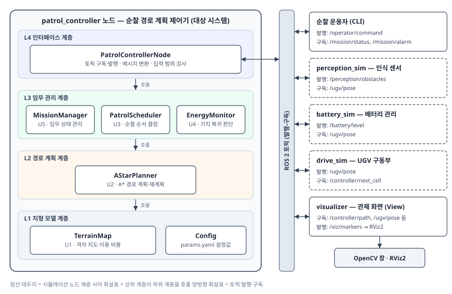<p class="cap">그림 2. 전체 아키텍처 — ROS 2 노드 구성과 제어기 내부 계층 구조</p></figure>

<figure>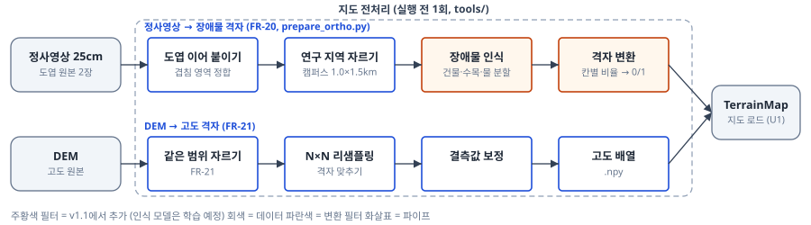<p class="cap">그림 3. 지도 전처리와 장애물 인식의 파이프-필터 구조</p></figure>

### 2.2 구조적 설계 (DFD → 구조도)

시스템 문맥도(그림 1)를 DFD Level 0으로 보고 처리 7개와 자료 저장소 2개로 분해했다(그림 4). D1(지형·장애물 지도)과 D2(순찰 지점 정보)는 과제1 기능점수의 ILF와 대응하고, 외부 개체와 주고받는 흐름은 Level 0과 같다(균형). 처리를 실행 순서에 따라 분해한 구조도(그림 5)의 모듈은 클래스의 메서드로 대응된다(예: 1.4 → `EnergyMonitor.update_return_map()`, 3.2 → `AStarPlanner.plan()`).

<figure>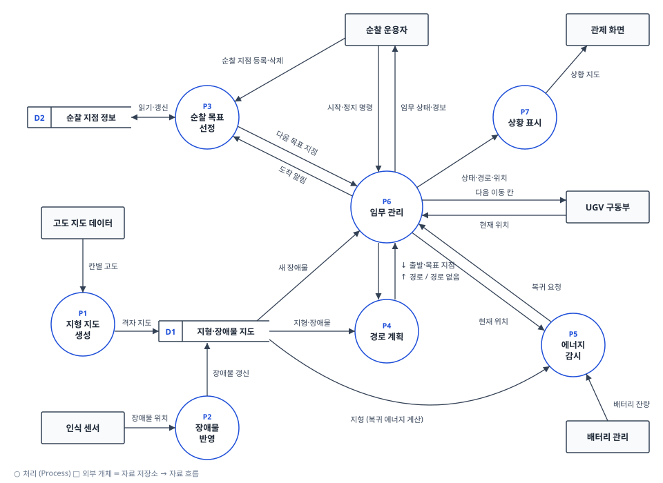<p class="cap">그림 4. 순찰 경로 계획 제어기 DFD Level 1</p></figure>

<figure>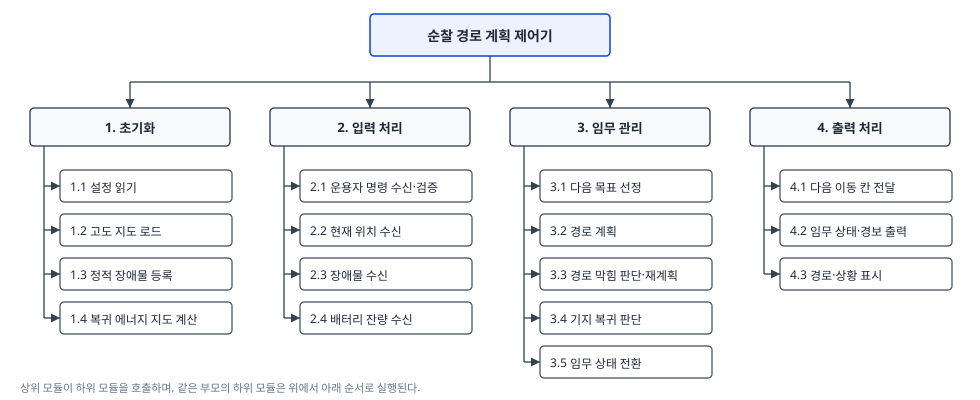<p class="cap">그림 5. 순찰 경로 계획 제어기 구조도</p></figure>

### 2.3 객체지향 설계 (UML)

- **유스케이스 (그림 6):** UC-03 순찰 수행은 UC-04 경로 계획을 항상 포함(include)하고, 장애물 발견·배터리 부족 조건에서만 UC-05, UC-06으로 확장(extend)된다.
- **클래스 (그림 7):** 핵심 클래스 5개가 유닛 U1\~U5이며, 연관은 모두 상위 계층 → 하위 계층 방향이다. Config는 읽기 전용으로 생성 시 전달된다.
- **순차 (그림 8):** 가장 많은 객체가 참여하는 장애물 재계획(UC-05) 흐름이다.
- **상태 기계 (그림 9):** FR-15의 임무 상태 5개와 전환 조건. 움직이는 세 상태를 상위 상태 "운행 중"으로 묶어 어느 상태에서든 정지 명령을 받는다.

<figure>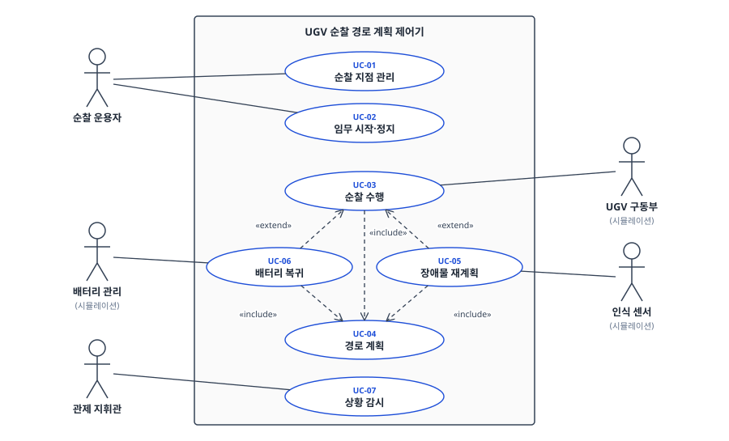<p class="cap">그림 6. 유스케이스 다이어그램</p></figure>

<figure>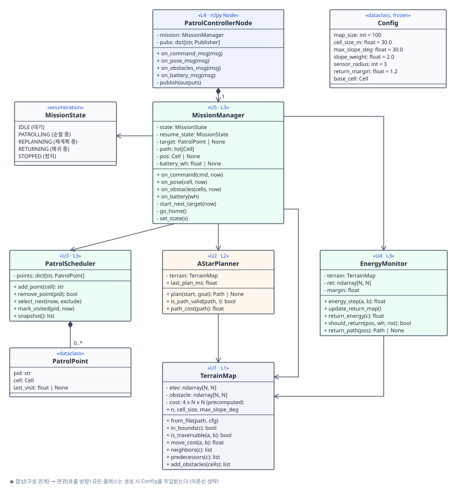<p class="cap">그림 7. 클래스 다이어그램 (U1~U5: 유닛 ID, L1~L4: 계층)</p></figure>

<figure>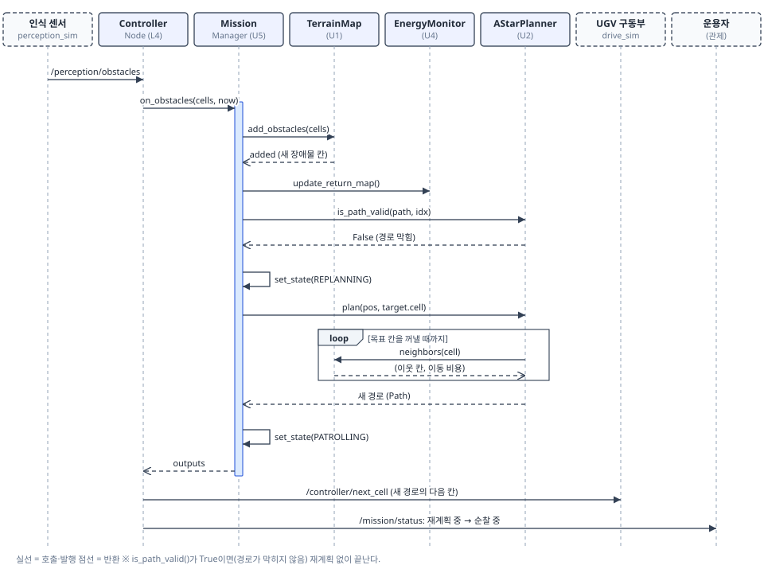<p class="cap">그림 8. 순차 다이어그램 — 순찰 중 경로 위에 새 장애물이 감지된 경우</p></figure>

<figure>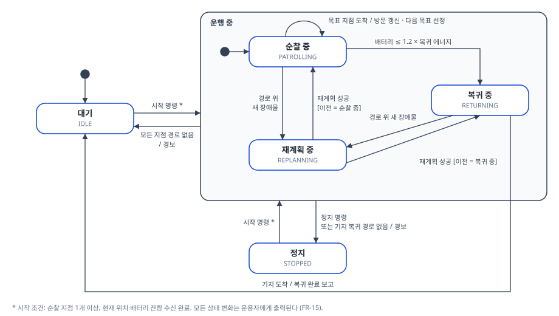<p class="cap">그림 9. MissionManager의 임무 상태 기계 다이어그램</p></figure>

산출물 간 일관성: 클래스 5개가 유스케이스의 지형 지도·경로·순찰 지점·복귀 에너지·임무 상태 개념과 대응하고(기능 ↔ 구조), 그림 8의 액터가 UC-05와 일치하며(기능 ↔ 행위), 그림 8의 메시지는 모두 그림 7의 연산이고 그림 9의 상태는 MissionManager의 state 속성이다(구조 ↔ 행위). 이 일관성이 코드에서도 유지되는지는 TC-D-01\~03으로 시험했다.

### 2.4 토픽 인터페이스

칸 좌표는 `geometry_msgs/Point`의 x = 행, y = 열로 표현하며, 모든 수치는 모든 노드가 같은 설정 파일에서 읽는다(NFR-05).

| 토픽 | 메시지 타입 | 발행 → 구독 | 내용 |
|---|---|---|---|
| /operator/command | std_msgs/String | 운용자 → controller | `start`, `stop`, `add <행> <열>`, `remove <지점ID>` |
| /ugv/pose | geometry_msgs/Point | drive_sim → controller, 시뮬, visualizer | 현재 칸 |
| /controller/next_cell | geometry_msgs/Point | controller → drive_sim | 다음 이동 칸 |
| /perception/obstacles | geometry_msgs/PoseArray | perception_sim → controller, visualizer | 반경 3칸 안 장애물 칸 목록 |
| /battery/level | std_msgs/Float32 | battery_sim → controller | 배터리 잔량 [Wh] |
| /controller/path | nav_msgs/Path | controller → visualizer | 현재 계획 경로 |
| /mission/status, /mission/alarm | std_msgs/String | controller → 운용자, visualizer | 임무 상태(JSON), 경보 |
| /viz/markers | visualization_msgs/MarkerArray | visualizer → RViz2 | 지형·경로·UGV·장애물 마커 |

### 2.5 설계 품질 평가 (응집도·결합도)

| 모듈 | 응집도 | 결합도 |
|---|---|---|
| TerrainMap (U1) | 교환적 — 모든 연산이 같은 격자 데이터를 사용 | 다른 모듈을 참조하지 않음 |
| AStarPlanner (U2) / EnergyMonitor (U4) | 기능적 — 최소 비용 경로 / 복귀 필요 판단 | TerrainMap과 데이터 결합 (공개 메서드만 사용) |
| PatrolScheduler (U3) | 교환적 — 같은 순찰 지점 표를 사용 | 좌표·시각만 받는 데이터 결합 (지형을 모름) |
| MissionManager (U5) | 순차적 — 이벤트 → 판단 → 상태 전환 → 출력 | U2\~U4와 데이터 결합 |
| 노드 간 | 기능적 — 노드마다 한 기능 | 토픽 메시지로만 주고받는 데이터 결합 |

설정값은 전역 변수 대신 읽기 전용 객체로 생성자에 전달해 공통 결합을 피했고, 다른 클래스의 비공개 속성에 접근하지 않아 내용 결합도 없다.

### 2.6 실제 지역 지도 데이터 (v1.1\~v1.3)

| 항목 | 데이터와 처리 (도구) | 결과 |
|---|---|---|
| 항공 정사영상 (FR-20, 21) | 국토지리정보원 2025년 25 cm 정사영상 도엽 2장을 영상 정합(일치도 1.000)으로 이어 붙여 캠퍼스를 자르고, OSM 건물 윤곽에 맞춰 위치를 13 m 보정 (`prepare_ortho.py`, `georef.py`) | 캠퍼스 1 km × 1 km를 10 m 칸 100×100 격자로 사용 |
| 장애물 인식 (FR-20, NFR-08) | LoveDA로 학습한 DeepLabV3(ResNet-50). 정답은 검증 영역 200 m × 200 m를 모델 결과를 가린 채 직접 라벨링 (`label_tool.py`) | 건물+나무 IoU 0.63 (같은 정답으로 OSM은 0.25) |
| 고도와 등판각 (FR-03, 21) | Copernicus GLO-30을 칸 중심마다 이중선형 보간 (`campus_world.py`). 등판각별로 막히는 이동을 세어 기준 결정 | 30°: 0곳, 20°: 2곳, **15°: 46곳** → 캠퍼스 15° (v1.3) |

## 3. 유닛 구성

제어기의 핵심 기능을 직접 구현하고 ROS 2 없이 단독으로 시험할 수 있는 L1\~L3의 유닛 5개를 상세 설계 대상으로 정했다. 공통 자료형은 Cell = (행, 열), Path = 4방향으로 이어진 Cell 목록, PatrolPoint = (pid, cell, last_visit), MissionState = 임무 상태 5개, Config = 설정 파일 값을 담은 읽기 전용 객체이다.

| ID | 유닛 | 계층 | 책임 | 핵심 알고리즘 | 관련 요구사항 |
|---|---|---|---|---|---|
| U1 | TerrainMap | L1 | 고도·장애물 보관, 통행 가능 여부와 이동 비용 | θ = arctan(Δh / 칸 크기), 비용 = 칸 크기 × (1 + w·θ/θmax), θ > θmax이면 ∞ | FR-01\~04, 11, NFR-02, 04 |
| U2 | AStarPlanner | L2 | 최소 비용 경로, 경로 유효성 검사 | A\*, h = 맨해튼 거리 × 칸 크기 (허용 가능) | FR-05, 06, 12, NFR-01, 02 |
| U3 | PatrolScheduler | L3 | 순찰 지점 관리, 다음 목표 선정 | 최장 대기 우선, 동점은 먼저 등록된 지점 | FR-07, 09, 10 |
| U4 | EnergyMonitor | L3 | 복귀 에너지 지도, 복귀 판단 | 기지에서 역방향 다익스트라, 잔량 ≤ 1.2 × R이면 복귀, 한 칸 앞 예측 | FR-13, 14, 19, NFR-03 |
| U5 | MissionManager | L3 | 이벤트 처리, 임무 상태 전환(그림 9) | 상태 전환표, 재계획·복귀 결정 | FR-06, 08, 10, 12, 14\~16, NFR-04 |

# 제4부. 구현 및 시험 [과제4]

제3부의 유닛 설계를 코드로 구현하고(1\~2장), 요구사항·설계·구현을 각각 대상으로 Test Case를 작성해 실행했다(3장). 4장에서 요구사항부터 시험까지의 추적 관계를 정리한다.

## 1. 구현 개요

### 1.1 개발 환경과 구현 순서

| 구분 | 내용 |
|---|---|
| 실행 환경 | Windows 11 + WSL2 Ubuntu 24.04, ROS 2 Jazzy (rclpy, rclcpp), RViz2 |
| 언어·라이브러리 | Python 3 (NumPy, OpenCV, PyYAML), C++17 (표준 라이브러리만 사용), 지도 전처리는 PyTorch |
| 시험 도구 | pytest, GoogleTest(ctest), ROS 2 시나리오 시험 스크립트, Docker + GitHub Actions(push마다 전체 시험) |
| 구현 순서 | 계층 아래부터 U1 → U2 → U3·U4 → U5 → L4·시뮬레이션·표시 노드. 각 유닛은 단위 시험을 통과한 뒤 다음 유닛에서 사용 (상향식 통합) |

요구사항, 설계, 시험 기준은 직접 정의했고 구현에는 AI 코딩 도구(Claude Code)를 보조로 활용했다. 시험에서 발견한 성능 문제와 결함은 원인을 분석해 고쳤다(3.5절).

### 1.2 코드 구성 — 설계가 코드가 되는 방식

저장소는 설계의 계층과 노드 구성이 그대로 폴더와 파일이 되도록 나눴다. 같은 클래스 설계를 Python과 C++ 두 언어로 구현했으며, C++ 핵심 라이브러리 `ugv_core`는 ROS 2 노드, 명령줄 도구, 웹 데모(WebAssembly) 세 곳에서 그대로 재사용한다.

```
UGV_Patrol_Planner/
├─ ugv_patrol_planner/        Python 패키지 (ROS 2 ament_python)
│  ├─ common.py               공통 자료형 Cell·Path·PatrolPoint·MissionState·Config
│  ├─ terrain/terrain_map.py  U1 TerrainMap                         L1 지형 모델
│  ├─ planning/astar.py       U2 AStarPlanner                       L2 경로 계획
│  ├─ mission/                U3 scheduler · U4 energy · U5 manager L3 임무 관리 (+ flags: FR-22)
│  └─ nodes/                  controller_node(L4) · perception/battery/drive_sim · visualizer(View)
├─ cpp/                       C++17 이식 (ROS 2 ament_cmake)
│  ├─ include/ugv_core/, src/ U1~U5 핵심 라이브러리 (ROS 2 의존 없음)
│  ├─ node/                   rclcpp 제어기 노드 (L4, 실행 인자 controller:=cpp로 교체)
│  └─ test/, web/, tools/     GoogleTest 37개 / WebAssembly 웹 데모 / 경로 계산 CLI ugv_plan
├─ share/                     config(설정 yaml) · scenarios · launch · rviz · data(.npy 지도)
├─ tools/                     지도 전처리 필터 (prepare_ortho, georef, campus_world, label_tool …)
├─ test/                      pytest 83개 (test_u1~u5 = 유닛 시험 UT-U1~U5)
└─ scripts/                   build · run · ci.sh · scenario_test.py(S1~S5) · Dockerfile
```

| 설계 요소 | Python | C++ |
|---|---|---|
| L1 지형 모델 (U1, Config) | `terrain/terrain_map.py`, `common.py` | `terrain_map.hpp/.cpp`, `node/config.cpp` |
| L2 경로 계획 (U2) | `planning/astar.py` | `astar.hpp/.cpp` |
| L3 임무 관리 (U3, U4, U5) | `mission/scheduler.py`, `energy.py`, `manager.py` | `scheduler`, `energy`(ReturnEnergyMap), `mission` |
| L4 인터페이스 | `nodes/controller_node.py` | `node/controller_node.cpp` |
| 시뮬레이션·View 노드 | `nodes/*_sim.py`, `visualizer.py` | (Python 노드를 두 제어기가 공용) |
| 파이프-필터 (지도 전처리) | `tools/*.py`, 학습 노트북 | - |

코드 구성 원칙은 설계 원칙을 코드 수준의 규칙으로 옮긴 것이다.

- **의존 방향:** 파일은 자기보다 아래 계층만 import(#include)한다. `rclpy`·`rclcpp`는 L4 파일에만 있다(TC-D-03).
- **출력 반환형 이벤트 처리:** U5는 토픽을 직접 발행하지 않고 출력 객체 목록(NextCell, PathUpdate, Status, Alarm)을 반환하며, L4가 이를 메시지로 바꾼다. 그래서 U5를 ROS 2 없이 시험할 수 있고, 제어기를 C++로 바꿔도 다른 노드는 바뀌지 않는다.
- **설정 주입:** 모든 수치는 읽기 전용 `Config`(Python `frozen` dataclass)로 생성자에 전달한다. 캠퍼스 15°는 코드가 아니라 `share/config/campus.yaml`에 있다(NFR-05).
- **두 구현의 동일성:** 이웃 탐색 순서(상·하·좌·우)와 동점 처리 규칙을 두 언어에서 똑같이 맞춰, 같은 입력에 칸 단위로 같은 경로가 나온다(TC-D-05).

### 1.3 구현 규모 — 계획 대비 실적

과제1의 LOC 추정과 Python 구현의 실제 줄 수(빈 줄·주석·문서 문자열 포함)를 비교했다.

| 모듈 (과제1 5.1) | 추정 LOC | 실제 파일 | 실제 줄 수 | 비율 |
|---|---|---|---|---|
| 지형 지도 및 비용 모델 | 113 | `terrain_map.py` | 126 | 1.1배 |
| A\* 경로 계획 및 재계획 | 72 | `astar.py` | 72 | 1.0배 |
| 순찰·임무 관리 | 92 | `scheduler.py`, `energy.py`, `manager.py` | 345 | 3.8배 |
| 시뮬레이션 노드 | 92 | `perception/battery/drive_sim.py`, `world.py` | 181 | 2.0배 |
| ROS 2 노드 구성 (launch 포함) | 62 | `controller_node.py`, `patrol.launch.py` | 204 | 3.3배 |
| 시각화 | 103 | `visualizer.py`, `rviz_view.py` | 286 | 2.8배 |
| **합계** | **533** | | **1,214** | **2.3배** |

알고리즘 모듈(U1, U2)은 추정과 거의 같았지만, 임무 관리와 노드는 3배 이상 커졌다. 추정할 때는 정상 흐름만 생각했는데, 실제 코드의 상당 부분이 잘못된 입력 처리(NFR-04), 상태 보고(FR-15), 재계획·복귀 중 예외 분기, QoS 설정이었기 때문이다. 이 밖에 추정에 없던 공통 자료형·깃발 배치(149줄), C++ 이식(핵심 868줄, 노드 258줄), 지도 전처리 도구(약 1,040줄), 시험 코드(Python 791줄, C++ 664줄, 시나리오 313줄)가 추가되었다.

## 2. 유닛(객체) 설계 — 코드 결과물

제3부 3장의 유닛 5개를 모두 클래스로 구현했다. 각 유닛은 클래스 명세(+ 공개, − 비공개), 핵심 코드 발췌, 설계 대비 구현 변경점 순으로 기술한다. 코드는 저장소의 실제 코드이며 설명용 주석만 한글로 바꿨다.

### 2.1 U1. TerrainMap — 지형 지도 및 이동 비용

| 구분 | 멤버 | 설명 |
|---|---|---|
| 속성 | − `_elev`, − `_obstacle`, − `_cost`, + `n`, + `cell_size`, + `max_slope_deg` | N×N 고도·장애물, 4방향 × N×N 이동 비용 표, 설정값 |
| 생성 | + `from_file(path, cfg, obstacle_path)` | 고도·장애물 파일 로드. 크기가 다르거나 NaN이면 ValueError (FR-01, 02) |
| 판단 | + `is_traversable(a, b)`, + `move_cost(a, b)` | 비용 표 조회, 통행 불가면 ∞ (FR-03, 04) |
| 탐색 지원 | + `neighbors(c)`, + `predecessors(c)` | 통행 가능한 4방향 이웃 / 역방향 이웃 (U2, U4가 사용) |
| 갱신 | + `add_obstacles(cells)` | 범위 안의 새 장애물만 등록하고 반환 (FR-11, NFR-04) |

```python
def _build_costs(self) -> list:           # 지도를 읽을 때 한 번만 실행
    n, e = self.n, self._elev
    costs = []
    for dr, dc in MOVES:                   # 상, 하, 좌, 우
        cost = np.full((n, n), math.inf)
        src = (slice(max(-dr, 0), n - max(dr, 0)), slice(max(-dc, 0), n - max(dc, 0)))
        dst = (slice(max(dr, 0), n - max(-dr, 0)), slice(max(dc, 0), n - max(-dc, 0)))
        slope = np.degrees(np.arctan(np.abs(e[dst] - e[src]) / self.cell_size))
        ok = slope <= self.max_slope_deg + _EPS          # 경계값 30.0°의 부동소수점 오차 흡수
        cost[src] = np.where(ok, self.cell_size * (1 + self.slope_weight * slope / self.max_slope_deg), math.inf)
        costs.append(cost.tolist())
    return costs

def add_obstacles(self, cells: Iterable[Cell]) -> list[Cell]:
    added = []
    for c in cells:
        c = (int(c[0]), int(c[1]))
        if self.in_bounds(c) and not self._obstacle[c]:  # 범위 밖·중복은 무시 (NFR-04)
            self._obstacle[c] = True
            added.append(c)
            for d, (dr, dc) in enumerate(MOVES):         # c로 "들어오는" 이동만 ∞로
                a = (c[0] - dr, c[1] - dc)
                if self.in_bounds(a):
                    self._cost[d][a[0]][a[1]] = math.inf
    return added
```

**설계 → 구현:** 설계에서는 이웃을 볼 때마다 경사를 계산했으나, 재계획 시간이 NFR-01 한계에 걸려(3.5절 결함 1) 이동 비용 표 `_cost`를 미리 계산하도록 바꿨다. 공개 메서드는 그대로라 U2·U4 코드는 바뀌지 않았다(정보 은닉의 효과).

### 2.2 U2. AStarPlanner — A\* 경로 계획

| 구분 | 멤버 | 설명 |
|---|---|---|
| 속성 | − `_terrain`, + `last_plan_ms` | 지형 모델 참조, 마지막 계획 소요 시간 (NFR-01 감시용) |
| 연산 | + `plan(start, goal)` | 최소 비용 경로 또는 None (FR-05, 06) |
| 연산 | + `is_path_valid(path, from_idx)`, + `path_cost(path)` | 현재 위치 이후 이동이 아직 통행 가능한지 (FR-12) / 경로 비용 |
| 내부 | − `_h(c, goal)`, − `_search()`, − `_reconstruct()` | 휴리스틱, 탐색 본체, 경로 복원 |

```python
while open_heap:
    _, _, _, cur = heapq.heappop(open_heap)   # (f, h, 순번, 칸): f 동점이면 h가 작은 칸, 그다음 먼저 넣은 칸
    if cur in closed:
        continue                              # 이미 확정된 칸의 오래된 항목
    if cur == goal:
        return self._reconstruct(came_from, goal)
    closed.add(cur)
    for nb, cost in t.neighbors(cur):         # 통행 가능한 이동만 → 경로에 위험한 이동이 들어갈 수 없음 (NFR-02)
        if nb in closed:
            continue
        ng = g[cur] + cost
        if ng < g.get(nb, math.inf):
            g[nb] = ng
            came_from[nb] = cur
            h = self._h(nb, goal)             # 맨해튼 거리 × 칸 크기 ≤ 실제 비용 (허용 가능)
            heapq.heappush(open_heap, (ng + h, h, next(seq), nb))
return None                                   # 경로 없음 → U5가 경보 (FR-06)
```

**설계 → 구현:** 우선순위 큐 항목에 순번을 넣어 동점 처리 순서를 결정적으로 만들었다. 덕분에 C++ 구현과 경로가 칸 단위로 같아졌다(TC-D-05). `plan()`은 `try/finally`로 실패해도 소요 시간을 남겨, L4가 재계획 시간이 0.5초를 넘으면 경고 로그를 낸다.

### 2.3 U3. PatrolScheduler — 순찰 순서 결정

| 구분 | 멤버 | 설명 |
|---|---|---|
| 속성 | − `_points`, − `_next_id` | 등록 순서를 유지하는 지점 ID → PatrolPoint 표, 다음 ID 번호 |
| 연산 | + `add_point(cell)`, + `remove_point(pid)` | 등록(같은 칸은 기존 ID 반환)·삭제(없는 ID는 False) (FR-07) |
| 연산 | + `select_next(now, exclude)`, + `mark_visited(pid, now)` | 최장 대기 지점 선정 (FR-09) / 방문 시각 갱신 (FR-10) |
| 조회 | + `snapshot()`, + `__len__()` | 상태 보고용 복사본, 지점 수 |

```python
def select_next(self, now: float, exclude: Iterable[str] = ()) -> Optional[PatrolPoint]:
    exclude = set(exclude)                    # U5가 경로 없는 지점을 뺄 때 사용
    best, best_wait = None, -math.inf
    for p in self._points.values():           # 등록 순서대로
        if p.pid in exclude:
            continue
        wait = math.inf if p.last_visit is None else now - p.last_visit   # 미방문 지점이 가장 먼저
        if wait > best_wait:                  # 같으면 먼저 등록된 지점 유지
            best, best_wait = p, wait
    return best
```

**설계 → 구현:** 현재 시각을 매개변수로 받게 해, 같은 코드가 ROS 2 시각과 시험용 가상 시각 모두에서 동작한다. U3는 지형을 전혀 모르므로(데이터 결합) 순서 규칙만 따로 시험할 수 있다.

### 2.4 U4. EnergyMonitor — 기지 복귀 판단

| 구분 | 멤버 | 설명 |
|---|---|---|
| 속성 | + `base`, + `margin`, − `_ret`, − `_h` | 기지 칸, 여유 배율 1.2, 칸별 복귀 에너지 R, 고도 캐시 |
| 연산 | + `energy_step(a, b)` | 한 칸 이동 에너지 = 거리분 + 오르막분. battery_sim도 같은 함수 사용 (FR-19) |
| 연산 | + `update_return_map()` | 기지에서 역방향 다익스트라로 R 재계산. 시작 시와 장애물 추가 시 호출 (FR-13) |
| 연산 | + `should_return(pos, wh, next_cell)`, + `return_path(pos)` | 복귀 판단 (FR-14, NFR-03) / R을 따라가는 최소 에너지 복귀 경로 |

```python
def should_return(self, pos: Cell, battery_wh: float, next_cell: Optional[Cell] = None) -> bool:
    if battery_wh <= self.margin * self._ret[pos]:             # 지금 위치 기준 (FR-14)
        return True
    if next_cell is not None:                                  # 한 칸 앞 예측 (NFR-03)
        predicted = battery_wh - self.energy_step(pos, next_cell)
        if predicted <= self.margin * self._ret[next_cell]:
            return True
    return False
```

**설계 → 구현:** `energy_step`을 모듈 함수로도 두어 battery_sim 노드가 같은 식으로 잔량을 줄이게 했다. 판단에 쓰는 에너지와 시뮬레이션에서 실제로 소모되는 에너지가 같아야 NFR-03을 보장할 수 있기 때문이다. R 재계산은 NumPy 원소 접근 대신 리스트와 `predecessors()`로 바꿔 빠르게 했다(3.5절 결함 2).

### 2.5 U5. MissionManager — 임무 상태 관리

| 구분 | 멤버 | 설명 |
|---|---|---|
| 속성 | + `state`, − `resume_state`, + `target`, + `path`, + `idx`, + `pos`, + `battery_wh` | 현재 상태, 재계획 후 돌아갈 상태, 목표, 경로와 진행 위치, 위치·잔량 |
| 이벤트 | + `on_command(cmd, now)`, + `on_pose(cell, now)` | 명령 처리 (FR-07, 08, NFR-04) / 진행·도착·복귀 판단·다음 칸 (FR-10, 13, 14, 16) |
| 이벤트 | + `on_obstacles(cells, now)`, + `on_battery(wh)` | 장애물 반영·재계획 (FR-11, 12) / 잔량 갱신 |
| 내부 | − `_start_next_target()`, − `_step()`, − `_go_home()`, − `_set_state()` | 목표 선정·계획, 다음 칸, 복귀, 상태 변경 시 Status 출력 (FR-15) |
| 출력 형 | `NextCell`, `PathUpdate`, `Status`, `Alarm`, `Command`, `parse_command()` | L4와 주고받는 값 객체. 잘못된 명령 문자열은 ValueError → L4가 경보로 변환 |

```python
def on_obstacles(self, cells: Iterable[Cell], now: float) -> list[Output]:
    if not self.terrain.add_obstacles(cells):                  # U1: 새 장애물이 없으면 끝
        return []
    self.energy.update_return_map()                            # U4: 복귀 에너지 지도 갱신
    if self.state not in (S.PATROLLING, S.RETURNING) or self.planner.is_path_valid(self.path, self.idx):
        return []                                              # 경로 밖 장애물이면 출력 없음
    self.resume_state = self.state
    out = self._set_state(S.REPLANNING)                        # Status 출력 (FR-15)
    if self.resume_state == S.RETURNING:
        return out + self._go_home()
    new_path = self.planner.plan(self.pos, self.target.cell)   # U2: 현재 위치에서 재계획 (FR-12)
    if new_path is None:
        out.append(Alarm(f'경로 없음: {self.target.pid}'))      # FR-06, 다른 지점으로
        return out + self._start_next_target(now, exclude={self.target.pid})
    self.path, self.idx = new_path, 0
    return out + self._set_state(S.PATROLLING) + [PathUpdate(self.path)] + self._step()
```

위 메서드의 호출 순서(U1 → U4 → U2)가 순차 다이어그램(그림 8)의 메시지 순서와 같다. L4 노드는 반환된 목록을 형(type)에 따라 토픽으로 바꾸기만 한다.

### 2.6 C++ 객체 설계와 설계 대비 변경 사항

C++ 구현은 같은 클래스 설계를 언어의 특성에 맞게 옮겼다. Python의 출력 객체 목록은 `std::variant`로, None은 `std::optional`로, 칸은 비교 연산자를 가진 `struct Cell`로 표현했다.

| 변경 | 설계(과제3) | 구현 | 이유 / 영향 |
|---|---|---|---|
| 이동 비용 표 | 이웃마다 경사 계산 | `_cost` 표 사전 계산, 장애물 칸으로 들어오는 이동만 갱신 | NFR-01 / 공개 메서드 불변 |
| 명령 해석 | L4가 문자열 처리 | `Command` 값 객체와 `parse_command()`를 L3에 둠 | 잘못된 명령 처리를 단위 시험 가능하게 (NFR-04) |
| 깃발 배치 | 시나리오 설정 | `mission/flags.py` (도달 가능한 칸에서 시드 고정 무작위) | FR-22 (v1.1) |
| 토픽 QoS | 기본값 | 경로·상태는 Transient Local, 명령·경보는 Reliable | 늦게 켠 노드도 마지막 경로·상태를 받음 |
| 경로 이탈 처리 | 없음 (위치가 경로 위에 있다고 가정) | `on_pose()`에서 실제 위치가 남은 경로 밖이면 그 위치에서 재계획 | 3.5절 결함 4: 재계획 직전에 구동부가 옛 명령으로 움직이면 멈춤 |
| 이름 | EnergyMonitor | C++에서는 `ReturnEnergyMap` | 역할(복귀 에너지 지도)을 드러냄, 공개 연산은 같음 |

## 3. 시험 사례 (Test Case)

### 3.1 시험 전략

요구사항·설계·구현을 각각 시험 대상으로 삼아, V 모델의 시험 수준과 대응시켰다. 요구사항 대상 시험은 사용자가 원한 동작인지를 보는 Validation 성격이 강하고, 설계·구현 대상 시험은 명세대로 만들었는지를 보는 Verification이다.

| 시험 대상 | 시험 수준 | 기준 문서 | 관점 | 실행 수단 | TC |
|---|---|---|---|---|---|
| 요구사항 | 시스템·인수 시험 | 제2부 FR·NFR | 블랙박스: 토픽 입출력만 관찰 | `scenario_test.py` (실제 ROS 2 실행, Python·C++ 제어기 각각), IoU 평가 | TC-R-01\~07 |
| 설계 | 통합 시험·설계 검사 | 제3부 UML, 인터페이스, 계층 | 그레이박스: 유닛 간 협력과 구조 | pytest·GoogleTest의 다중 유닛 시험, 의존성 검사, `compare_cpp.py` | TC-D-01\~06 |
| 구현 | 단위 시험 | 제4부 2장 코드 | 화이트박스: 경계값, 예외 분기, 성능 | pytest `test_u1`\~`test_u5` (UT-U1\~U5), GoogleTest | TC-I-01\~08 |

각 Test Case는 ID, 대상, 사전 조건·입력, 기대 결과, 실제 결과, 판정으로 기술했다. 실제 결과는 2026-11-24에 WSL2(Ubuntu 24.04, ROS 2 Jazzy)에서 실행한 값이다.

### 3.2 요구사항 대상 Test Case (TC-R)

| ID | 대상 요구사항 | 사전 조건 · 입력 | 기대 결과 | 실제 결과 | 판정 |
|---|---|---|---|---|---|
| TC-R-01 (S1) | FR-07\~10, 16 | 기본 지도, 지점 (15,85)·(85,85)·(85,15) 등록 후 start, 방문 6회까지 | 세 지점 모두 방문, 지점별 방문 횟수 차이 ≤ 1 | P1·P2·P3 각 2회 방문 (차이 0) | 합격 |
| TC-R-02 (S2) | FR-11, 12, NFR-01, 02 | 기본 지도에 제어기가 모르는 장애물 벽(16칸)을 두고 순찰 | 재계획 발생, 장애물 보고 후 0.5초 안에 회피 경로, 장애물 칸 진입 없음 | 재계획 15회, 최대 재계획 지연 46 ms, 장애물 칸 진입 없음 | 합격 |
| TC-R-03 (S3) | FR-13, 14, NFR-03 | 초기 잔량 30 Wh(순찰을 끝낼 수 없는 양)로 순찰 | 복귀 중 → 기지 도착 → "복귀 완료", 최저 잔량 > 0 | 복귀 완료, 기지 도착, 최저 잔량 2.98 Wh | 합격 |
| TC-R-04 (S4) | FR-06, NFR-04 | `add 999 999`, `remove P9`, `go`, 지점 없이 `start`, 지도 밖 장애물 (500,500) | 경보 5개 이상, 프로그램 종료 없음, 이후 정상 순찰 시작 | 경보 5개, 종료 없음, 이후 순찰 시작 | 합격 |
| TC-R-05 (S5) | FR-03, 20\~22 | 캠퍼스 지도(인식 장애물, 등판 한계 15°), 시드 7로 깃발 3개 배치 후 순찰 | 같은 시드 같은 배치, 모든 깃발 방문, 장애물 칸 진입 0, 실제 이동 경사 ≤ 15° | 깃발 (64,21)·(3,1)·(35,48) 재현, 각 1회 방문, 진입 0, 이동 319회 중 최대 13.5° | 합격 |
| TC-R-06 | NFR-08, FR-20 | 검증 영역 200 m × 200 m의 직접 라벨(정답)과 모델 인식 결과 | 건물+나무 IoU ≥ 0.6 | IoU 0.63 (건물 0.75, 나무 0.56) | 합격 |
| TC-R-07 | NFR-05, FR-03 | 같은 코드로 기본 설정(30°)과 캠퍼스 설정(15°) 로드 (`test_campus_slope.py`) | 캠퍼스에서 15° 초과 이동이 막히고 경로가 한계 이하, 기본 지도는 30° 유지 | 막히는 이동 46곳, 경로 모두 15° 이하, 기본 30° 유지 | 합격 |

TC-R-01\~05는 같은 시험을 Python 제어기와 C++ 제어기로 각각 실행했고, 실제 결과는 Python 제어기 값이다. C++ 제어기 결과는 3.5절에 있다.

### 3.3 설계 대상 Test Case (TC-D)

| ID | 대상 설계 | 사전 조건 · 입력 | 기대 결과 | 실제 결과 | 판정 |
|---|---|---|---|---|---|
| TC-D-01 | 상태 기계 (그림 9) | 10×10 지도, 잔량 6 Wh, 순찰 중 경로 위 장애물 1회, 배터리를 소모하며 주행 (UT-U5-07) | Status 순서 순찰 중 → 재계획 중 → 순찰 중 → 복귀 중 → 대기, 기지에서 "복귀 완료" | 순서 일치, 기지 도착, 잔량 > 0 (C++ 동일) | 합격 |
| TC-D-02 | 순차 다이어그램 (그림 8) | 순찰 중 경로 위 장애물 / 경로 밖 장애물 (UT-U5-04), 장애물 추가 후 복귀 지도 (UT-U4-05) | 경로 위: 재계획 중 → 순찰 중, 새 경로가 장애물 회피, R 갱신. 경로 밖: 출력 없음 | 일치. (0,1) 막힘 후 R(0,2)가 2칸 → 4칸 분량으로 증가 | 합격 |
| TC-D-03 | 계층 구조 (그림 2, 7) | 모든 Python import, C++ #include 조사 | 상위 → 하위 방향만, L1\~L3에 ROS 2 의존 없음 | 위반 0건 (terrain → common, planning → terrain, mission → planning·terrain), 유닛 시험이 ROS 2 실행 없이 동작 | 합격 |
| TC-D-04 | 토픽 인터페이스 (2.4절) | 같은 시나리오 S1\~S5를 Python·C++ 제어기로 실행, Status JSON 비교 (StatusJsonMatchesPythonFormat) | 토픽 이름·타입·JSON 형식 동일, 다른 노드 수정 없이 교체 | JSON 형식 일치, C++ 제어기로도 S1\~S5 5/5 합격 | 합격 |
| TC-D-05 | 클래스 설계의 구현 독립성 | 지도 3종 × 무작위 출발·목표 100쌍을 Python·C++ A\*로 계획 (`compare_cpp.py`) | 모든 경로가 칸 단위로 같음 | 300/300 동일, 비용 차 최대 5×10⁻¹⁰. 평균 계획 시간 Python 4.2\~7.3 ms, C++ 0.18\~0.36 ms | 합격 |
| TC-D-06 | 파이프-필터 (그림 3) | 필터 출력: 장애물·분류·고도 격자, 좌표 변환 (`test_obstacle_classes`, `test_export_web`, `test_georef`) | 모든 장애물 칸에 분류가 있고 빈 칸엔 없음, 다음 단계로 고도가 손실 없이 전달, 좌표 왕복 오차 < 1 mm | 모두 일치 (고도 비트 단위 동일) | 합격 |

### 3.4 구현 대상 Test Case (TC-I)

| ID | 대상 코드 | 사전 조건 · 입력 | 기대 결과 | 실제 결과 | 판정 |
|---|---|---|---|---|---|
| TC-I-01 | U1 `_build_costs` 경계값 (UT-U1-02) | 경사 29.9°, 30.0°, 30.1°인 3×3 지도 | 통행 가능, 가능, 불가 (30.0°는 `_EPS` 분기) | 가능, 가능, 불가 | 합격 |
| TC-I-02 | U1 `from_file` 예외 분기 (UT-U1-01) | 100×100 파일 / 99×100 파일 | n = 100·고도 일치 / ValueError | 일치 / ValueError | 합격 |
| TC-I-03 | U1 `add_obstacles` (UT-U1-04) | (1,1) 두 번, 범위 밖 (−1,0)·(100,5) | [(1,1)]만 반환, 들어오는 이동 ∞ / [] 반환, 예외 없음 | 일치 | 합격 |
| TC-I-04 | U2 `_search` 최적성 (UT-U2-02) | 무작위 지도 50개, h = 0인 다익스트라와 비교 | 경로 비용 동일 (휴리스틱 허용성) | 50개 모두 동일 | 합격 |
| TC-I-05 | U2 성능 (UT-U2-05) | 100×100, 긴 벽 우회, 대각선 끝점 20회 | 최대 0.5초 미만 | 평균 48 ms, 최악 64 ms | 합격 |
| TC-I-06 | U3 `select_next` 분기 (UT-U3-02, 03) | 방문 시각 P1 = 10, P2 = 5, P3 = 8, now = 20 / 미방문 지점 섞임 | P2 / 미방문 중 먼저 등록된 지점 | 일치 | 합격 |
| TC-I-07 | U4 `should_return` 분기 (UT-U4-03, 04) | 잔량 = 1.2R, 1.2R + 0.01 / 다음 칸이 10 m 오르막 | True, False / 현재 칸만 보면 False, 다음 칸까지 보면 True | 일치 | 합격 |
| TC-I-08 | U5 `parse_command`·`on_command` 오류 분기 (UT-U5-08) | `add 3 x`, `go`, `remove`, 빈 문자열 / 범위 밖 add, 없는 ID remove, 지점 0개 start | ValueError / 각각 경보, 상태 대기 유지, 예외 없음 | 일치 | 합격 |

Test Case는 시험 코드로 작성해 자동 실행한다. 예를 들어 TC-I-01은 경계값 세 개를 매개변수로 준다.

```python
@pytest.mark.parametrize('deg, ok', [(29.9, True), (30.0, True), (30.1, False)])
def test_ut_u1_02_slope_boundary(deg, ok):                       # TC-I-01
    assert slope_map(deg).is_traversable((0, 0), (0, 1)) is ok
```

### 3.5 시험 결과와 발견한 결함

| 시험 | 도구 | 규모 | 결과 |
|---|---|---|---|
| Python 단위·통합 시험 | pytest | 83개 (UT-U1\~U5 30개 + 지도·도구 시험) | 83개 통과 (3.3초) |
| C++ 단위·통합 시험 | GoogleTest (ctest) | 37개 (유닛, 임무, 시뮬레이션 S1\~S5) | 37개 통과 |
| Python ↔ C++ 경로 비교 | `compare_cpp.py` | 지도 3종 × 100쌍 | 300개 경로 동일 |
| ROS 2 시나리오 시험 | `scenario_test.py` | S1\~S5 × 제어기 2종 | 결함 4 수정 후 Python 5/5, C++ 5/5 합격 |
| 자동화 | GitHub Actions (Docker) | push마다 위 전체 | 통과 |

시험 과정에서 발견한 결함과 조치는 다음과 같다(C++ 제어기의 S2 최대 재계획 지연은 8 ms). 결함 1·2·4는 설계를 보완해 해결했고, 결함 3은 시험 코드 자체의 결함이었다.

| No. | 발견한 시험 | 현상 | 원인 | 조치 | 조치 후 |
|---|---|---|---|---|---|
| 1 | TC-I-05 (UT-U2-05) | 100×100 최악 재계획 0.4\~0.5초, NFR-01 한계 | 이웃을 볼 때마다 경사각 계산 | U1에 이동 비용 표 사전 계산 | 평균 48 ms, 최악 64 ms |
| 2 | TC-R-02 (S2, ROS 2) | 장애물이 들어올 때마다 복귀 지도 재계산 0.3\~0.5초, 메시지 처리 밀림 | NumPy 원소 단위 접근과 이웃 재계산 | `predecessors()`와 리스트 기반 계산 | 약 90 ms, S2 합격 |
| 3 | TC-R-03 (S3, 느린 PC) | 간헐적 불합격 | "복귀 완료" 상태와 기지 위치가 다른 토픽이라 도착 순서가 바뀜 | 판정 전에 기지 위치 메시지를 기다리도록 시험 수정 | 안정적으로 합격 |
| 4 | TC-R-01 (S1, C++) | 1회 불합격: 재계획 뒤 방문 0회 | 재계획 직전 구동부가 옛 명령으로 움직이면 새 다음 칸이 이웃이 아니라 무시됨 (UT-U5-09로 재현) | 실제 위치가 경로 밖이면 그 위치에서 재계획 | 두 제어기 S1\~S5 합격 |

## 4. 요구사항 추적표 (요구사항 → 설계 → 코드 → 시험)

| 요구사항 | 설계 (계층·유닛) | 코드 | Test Case |
|---|---|---|---|
| FR-01\~04 | L1 U1 | `terrain_map.py` / `.cpp` | TC-R-05, 07, TC-I-01\~03 |
| FR-05, 06 | L2·L3 U2, U5 | `astar.py`, `manager.py` | TC-R-04, TC-D-05, TC-I-04 |
| FR-07\~10 | L3 U3, U5 | `scheduler.py`, `manager.py` | TC-R-01, TC-I-06, 08 |
| FR-11, 12 | L1\~L3 U1, U2, U5 | `add_obstacles()`, `on_obstacles()` | TC-R-02, TC-D-02, TC-I-03 |
| FR-13, 14 | L3 U4, U5 | `energy.py` | TC-R-03, TC-D-01, TC-I-07 |
| FR-15, 16 | L3·L4 U5, 제어기 노드 | `manager.py`, `controller_node.py` / `.cpp` | TC-R-01, TC-D-01, 04 |
| FR-17\~19 | 시뮬레이션·표시 노드 | `nodes/*_sim.py`, `visualizer.py` | TC-R-01\~03 (센서·배터리 시뮬 사용), 그림 10 |
| FR-20\~22 | 파이프-필터, 깃발 배치 | `tools/*.py`, `mission/flags.py` | TC-R-05, 06, TC-D-06 |
| NFR-01, 02 | U1, U2 | `_cost` 표, `neighbors()` | TC-R-02, TC-I-05 |
| NFR-03 | U4, U5 | `should_return()` | TC-R-03, TC-D-01, TC-I-07 |
| NFR-04 | U1, U5, L4 | `parse_command()`, `add_obstacles()` | TC-R-04, TC-I-03, 08 |
| NFR-05 | Config | `common.py`, `share/config/*.yaml` | TC-R-07 |
| NFR-06, 07 | 노드 구조, 실행 환경 | `nodes/`, `cpp/node/`, `scripts/Dockerfile` | TC-D-03, 04 (ROS 2 위 S1\~S5 실행) |
| NFR-08 | 장애물 인식 필터 | `label_tool.py`, 학습 노트북 | TC-R-06 |

FR 22개와 NFR 8개가 모두 설계 요소, 코드, 하나 이상의 Test Case에 연결되며, 21개 Test Case가 모두 합격했다.

<figure>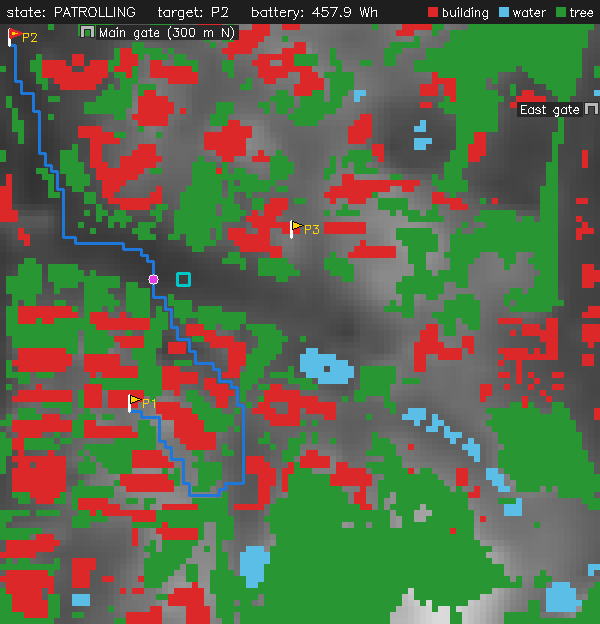 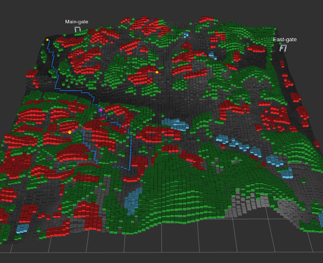<p class="cap">그림 10. 캠퍼스 순찰 실행 화면 (시연, FR-17) — 왼쪽 OpenCV 2D, 오른쪽 같은 순간의 RViz2 (높이 5배 강조)</p></figure>

## 5. 결과 요약과 향후 과제

- **유닛(객체) 설계:** 유닛 5개(U1\~U5)를 Python·C++17 클래스로 구현했고, 폴더 구성과 의존 방향 규칙으로 계층을 지켰다.
- **Test Case:** 요구사항 7개, 설계 6개, 구현 8개가 모두 합격했고, 자동 시험(3.5절)은 push마다 CI에서 다시 돈다.
- **배운 점:** 정상 흐름만 본 LOC 추정은 임무 관리에서 3.8배 빗나갔고, 결함은 정보 은닉 덕분에 내부만 고쳐 해결했다.
- **향후 과제:** D\* Lite로 재계획 효율화, 5 m 고도 자료 적용, 캠퍼스 데이터로 인식 모델 미세 조정, Gazebo 연동.
