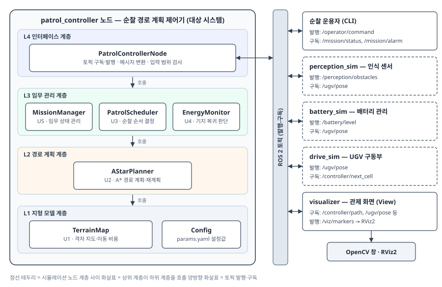
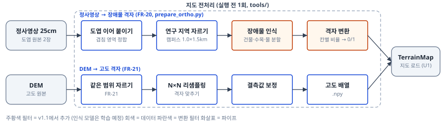
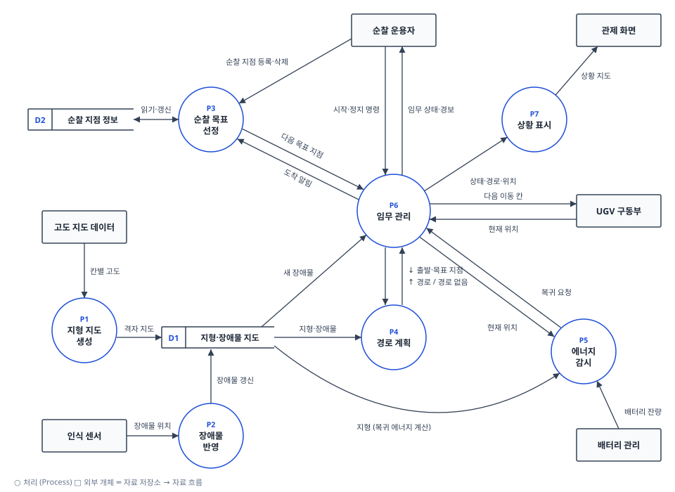
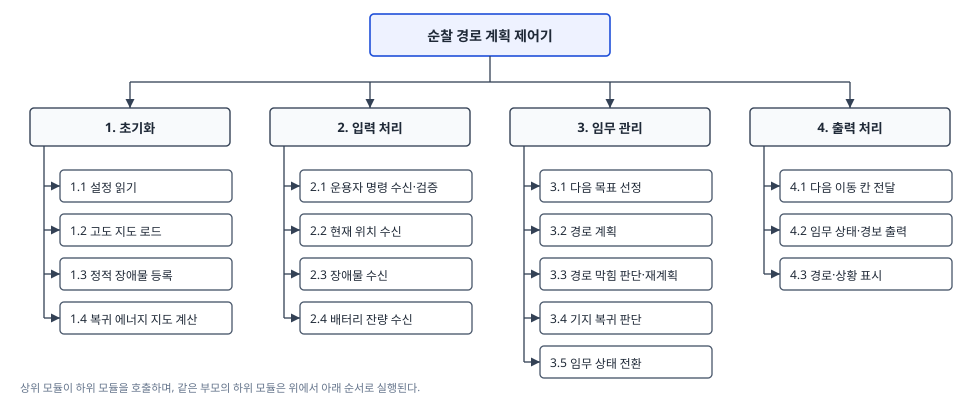
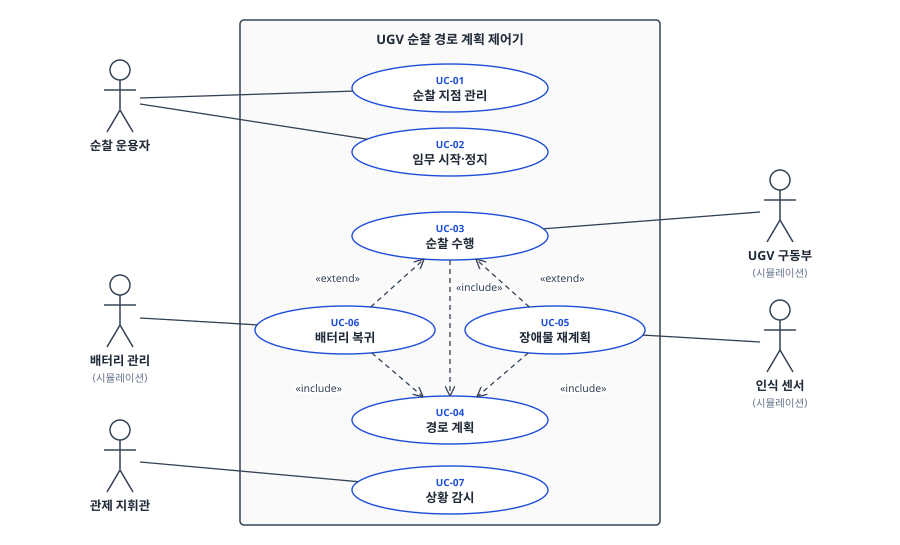
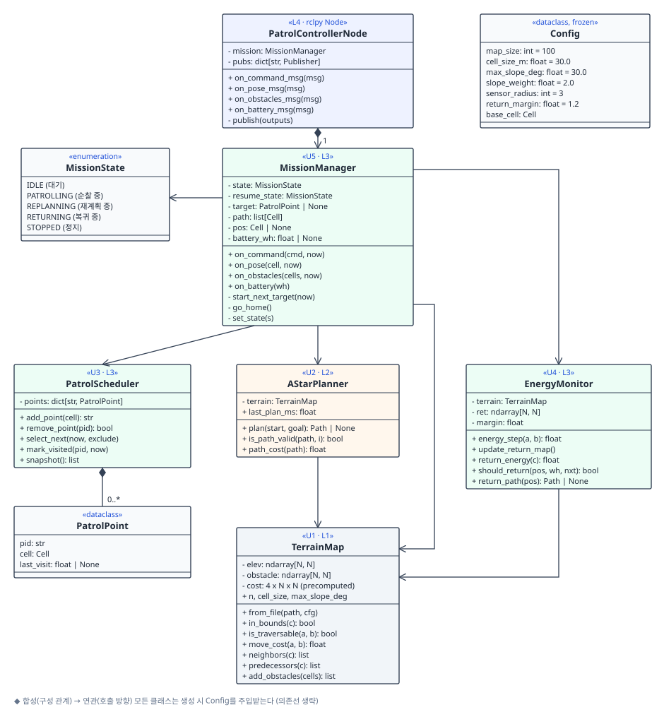
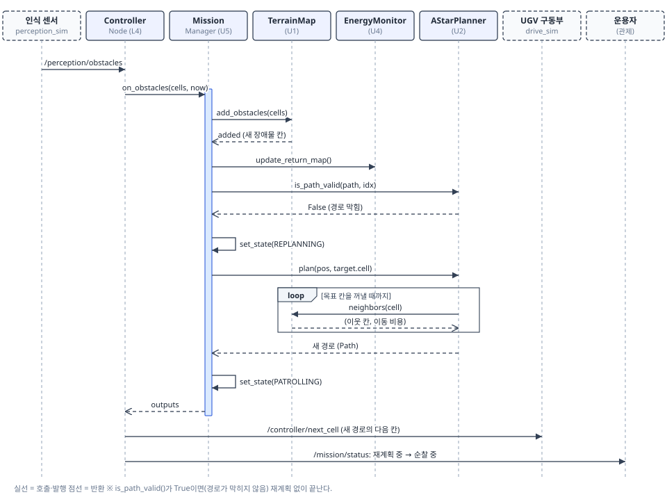
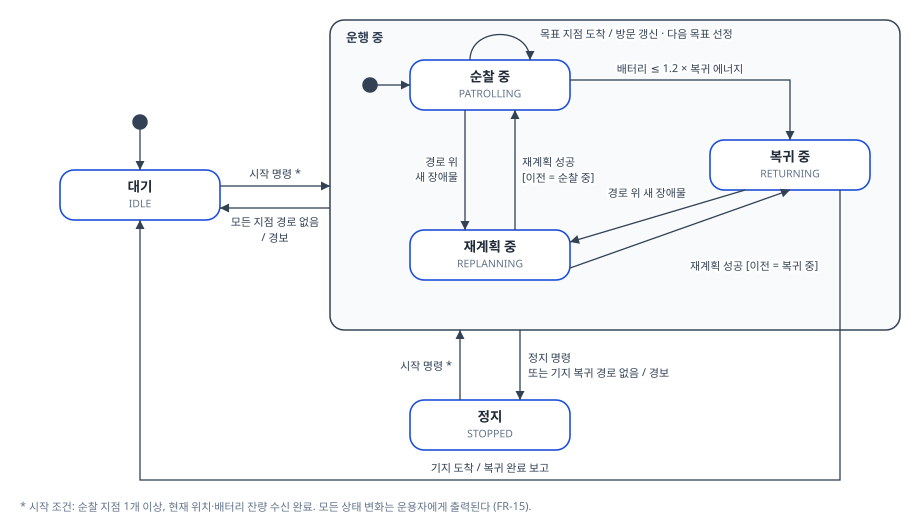

# 2.5D 지형 기반 UGV 순찰 경로 계획 제어기

<p class="subtitle">소프트웨어공학 과제 통합 문서 — [과제1] 프로젝트 관리 · [과제2] 요구사항 · [과제3] 설계</p>

| 구분 | 과제 | 내용 | 주요 산출물 |
|---|---|---|---|
| 제1부 | 과제1 | 프로젝트 관리 | 범위 정의, 시스템 문맥도, 이해관계자, 제약사항, 규모 산정, WBS |
| 제2부 | 과제2 | 요구사항 작성 | 기능 요구사항 FR-01~19, 비기능 요구사항 NFR-01~07, 검증 방법 |
| 제3부 | 과제3 | 설계 | 아키텍처 모델(계층·MVC·파이프-필터), DFD·구조도, UML, 토픽 인터페이스, 유닛 5개 상세 설계 |

**문서 연결 흐름:** 과제1에서 정한 범위와 시스템 문맥도(그림 1)를 바탕으로 과제2에서 요구사항을 ID로 정의했고, 과제3에서는 그 요구사항을 구성요소와 유닛에 배정했다. 요구사항 ID가 설계 요소와 시험 항목에 어떻게 연결되는지는 제3부 2.6절의 추적표에 정리했다.

# 제1부. 프로젝트 관리 [과제1]

범위 정의(Scope Definition), 이해관계자 및 대상 시스템 분석

## 1단계: 대상 제어기 선택

- **제어기 이름:** UGV 순찰 경로 계획 제어기 (Patrol Path Planning Controller)
- **역할:** 고도 정보가 있는 2.5D 격자 지형에서 순찰 지점의 방문 순서를 정하고, 각 지점까지의 경로를 A\* 알고리즘으로 생성한다. 순찰 중 새 장애물이나 배터리 부족 상황이 발생하면 경로나 임무를 다시 계획한다.
- **제어 계층:** 자율주행 UGV의 계획 구조(전역 경로계획 → 지역 경로계획 → 구동 제어) 중 전역 경로계획과 임무 관리 계층을 대상으로 한다.
- **선정 이유:** 지상 무인체계의 핵심 기술인 경로계획을 다루며, 하드웨어 없이 SILS(Software-in-the-Loop Simulation) 수준에서 알고리즘을 검증할 수 있다. 또한 인식·계획·임무 관리·구동을 ROS 2 노드로 분리하면 실제 무인체계의 소프트웨어 구조를 그대로 경험할 수 있다.

## 2단계: 프로젝트 범위 정의

### 2.1 프로젝트 목표

1. 2.5D 격자 지형에서 등판 한계를 넘는 경사를 피하는 순찰 경로를 생성한다.
2. 감시 공백이 가장 긴 지점을 우선 방문하여 순찰 지점 간 감시가 고르게 이루어지도록 한다.
3. 순찰 중 새 장애물이 감지되면 경로를 다시 계산한다.
4. 배터리가 부족해지면 순찰을 중단하고 기지로 복귀한다.
5. 인식·계획·임무 관리·구동·표시 기능을 ROS 2 노드로 분리하고, 노드 간 데이터를 토픽(발행-구독)으로 주고받는다.

### 2.2 범위 포함 사항

**[필수 구현]**

| 항목 | 내용 |
|---|---|
| 지도 데이터 | 공개 DEM(수치표고모델, SRTM 등)에서 구역을 잘라 N×N 격자 고도 지도로 사용한다(기본 100×100, 설정 가능). 장애물은 DEM에 없으므로 시험 상황에 맞게 코드로 추가한다. |
| 지형 경로 계획 | N×N 격자 지도(칸마다 고도, 장애물 여부)에서 A\* 알고리즘(4방향 이동)으로 경로를 생성한다. 등판 한계를 넘는 경사는 통행 불가로, 그 이하는 경사에 비례해 이동 비용을 높게 처리한다. |
| 순찰 순서 결정 | 마지막 방문 이후 가장 오래 지난 지점을 다음 목표로 정한다(최장 대기 우선). 가까운 지점만 반복 방문하여 먼 지점이 방치되는 문제를 막기 위함이다. |
| 장애물 재계획 | 센서 범위 안에서 새 장애물이 감지되어 경로가 막히면 현재 위치에서 경로를 다시 계산한다. |
| 배터리 복귀 | 기지 복귀에 필요한 에너지가 부족해지기 전에 순찰을 중단하고 복귀한다. |
| ROS 2 노드 구조 | 제어기와 시뮬레이션 요소(인식 센서, 배터리 관리, UGV 구동부)를 각각 ROS 2(rclpy) 노드로 구현하고, 토픽으로 데이터를 주고받는다. |
| 시각화 | 고도를 색의 명암으로 표시한 2D 격자 화면(OpenCV)에 경로, UGV 위치, 장애물을 표시하고, 같은 정보를 RViz2에서도 확인할 수 있도록 마커로 발행한다. |

**[선택 구현 (일정 여유 시)]**

- 포장로, 풀숲, 진흙 등 지형 유형별 이동 비용 차등 적용
- 최근 지나간 칸에 벌점을 주어 순찰 경로 다양화
- 통신 두절 시 정지 대기, 목표 지점 차단 시 건너뛰고 보고

### 2.3 범위 제외 사항

- 차량 동역학, 저수준 모터 제어, 지역 경로계획 (UGV는 칸 하나를 차지하는 점으로 가정)
- 실제 센서 연동, 딥러닝 기반 객체탐지, SLAM
- 이동 물체(보행자, 차량) 회피 및 적 노출 구역 고려
- 다중 UGV 협동 및 군집제어
- 터널 등 3차원 구조 표현
- Gazebo 등 물리 시뮬레이터 연동 (UGV 구동부는 단순 이동 모델로 대체)

## 3단계: 시스템 문맥도 및 이해관계자 분석

### 3.1 시스템 문맥도


*그림 1. UGV 순찰 경로 계획 제어기 시스템 문맥도 (○ 대상 시스템, □ 외부 개체, → 데이터 흐름)*

| 외부 개체 | 제어기로 들어오는 데이터 (입력) | 제어기에서 나가는 데이터 (출력) |
|---|---|---|
| 순찰 운용자 (관제) | 순찰 지점 지정, 시작·정지 명령 | 임무 상태, 경보 |
| 고도 지도 데이터 | 칸별 고도 | |
| 인식 센서 (시뮬레이션) | 센서 범위 안의 장애물 위치 | |
| 배터리 관리 (시뮬레이션) | 배터리 잔량 | |
| UGV 구동부 (시뮬레이션) | 현재 위치 | 다음 이동 칸 |
| 관제 화면 | | 고도 지도, 계획 경로, UGV 위치, 장애물 |

그림의 인식 센서, 배터리 관리, UGV 구동부는 각각 별도의 ROS 2 노드로 구현하여 토픽으로 제어기와 연결한다. 고도 지도는 시작 시 파일에서 읽고, 관제 화면은 OpenCV 창과 RViz2로 구성한다.

### 3.2 이해관계자 분석 (사용자 측면)

| 이해관계자 | 유형 | 역할 및 관심사 |
|---|---|---|
| 순찰 운용자 | 직접 사용자 | 순찰 지점 설정과 임무 시작·중지를 담당하며, 설정이 쉽고 이상 상황이 즉시 보고되는지를 중시한다. |
| 관제 지휘관 | 직접 사용자 | 순찰 상황을 감시·판단하며, 모든 지점이 고르게 감시되는지를 중시한다. |
| 정비·개발자 | 간접 사용자 | 기능 유지보수와 개선을 담당하며, 모듈 교체와 설정값 조정이 쉬운지를 중시한다. |
| 시험평가 담당자 | 간접 사용자 | 요구사항 충족 여부를 검증하며, 상황별 대응을 재현하고 확인할 수 있는지를 중시한다. |

## 4단계: 제약사항 조사

### 4.1 시스템 제약사항

수치는 모두 가정값이며 구현 시 설정값으로 조정한다.

| 구분 | 제약사항 |
|---|---|
| 기동 성능 | 최대 등판각 30°를 넘는 경사는 통행 불가. 칸 크기를 약 30m(SRTM 해상도)로 보면, 인접 칸의 고도차가 약 17m를 넘는 이동이 통행 불가 |
| 지도 규모 | 기본 100×100 격자(약 3km × 3km). 재계획 시간을 성능 시험에서 측정하여 규모를 조정 |
| 인식 | 센서는 UGV 주변 일정 반경(기본 3칸) 안의 장애물만 감지 |
| 실시간성 | 새 장애물 감지 후 0.5초 이내 재계획 완료 (목표치) |
| 에너지 | 이동 거리와 경사에 비례해 소모되며, 기지 복귀 에너지에 여유분(기본 20%)을 항상 확보 |

### 4.2 프로젝트 제약사항

| 구분 | 제약사항 |
|---|---|
| 인력·기간 | 1인 개발, 2학기 종강 전까지 목표 |
| 검증 환경 | 실제 차량 없이 시뮬레이션으로만 검증 |
| 개발 환경 | Windows 11 + WSL2(Ubuntu), ROS 2(rclpy), RViz2, Python(NumPy, OpenCV, Matplotlib), pytest. VS Code에서 WSL 확장으로 개발 |
| 비용 | 모두 무료 오픈소스 도구만 사용 |

### 4.3 프로젝트 위험 및 대응

| No. | 위험 | 치명도 | 발생 빈도 | 대응 |
|---|---|---|---|---|
| 1 | 구현 지연 | High | Mid | 필수 구현 항목부터 진행하고, 선택 구현 항목은 향후 확장으로 넘긴다. |
| 2 | 비용 설정 오류로 비현실적인 경로 생성 | Mid | Mid | 가중치를 설정값으로 분리해 시험하고, 필요 시 비용 항목을 거리와 경사로만 축소한다. |
| 3 | ROS 2 환경 구축과 학습이 예상보다 오래 걸림 | Mid | Mid | 구현 첫 단계에서 WSL2와 ROS 2 설치, 간단한 발행-구독 예제부터 확인한다. 그래도 어려우면 노드 구조 대신 Python 모듈과 자체 메시지 버스(발행-구독)로 대체한다. |

## 5단계: 프로젝트 규모 산정

### 5.1 LOC 기법

추정 LOC = (낙관치 + 4 × 기대치 + 비관치) / 6

| 모듈 | 낙관치 | 기대치 | 비관치 | 추정 LOC |
|---|---|---|---|---|
| 지형 지도 및 비용 모델 | 70 | 110 | 170 | 113.3 |
| A\* 경로 계획 및 재계획 | 50 | 70 | 100 | 71.7 |
| 순찰·임무 관리 (순찰 순서, 배터리 복귀) | 60 | 90 | 130 | 91.7 |
| 시뮬레이션 노드 (인식·배터리·UGV 구동부) | 60 | 90 | 130 | 91.7 |
| ROS 2 노드 구성 및 토픽 인터페이스 (launch 포함) | 40 | 60 | 90 | 61.7 |
| 시각화 (OpenCV 화면, RViz2 마커) | 70 | 100 | 150 | 103.3 |
| **합계** | | | | **약 533 LOC (0.53 KDSI)** |

### 5.2 기능점수(FP) 기법

ROS 2 노드 구조는 같은 기능을 구현하는 방식의 차이이므로 식별되는 기능의 수는 달라지지 않는다. 따라서 기능점수와 개발비는 그대로 두고, 노드 구성에 드는 노력은 LOC와 일정에 반영했다.

**(1) 기능 식별**

| 유형 | 기능 |
|---|---|
| ILF (내부 논리 파일) | 순찰 지점 정보, 장애물 지도 |
| EIF (외부 인터페이스 파일) | 고도 지도 데이터, 배터리 상태 정보 |
| EI (외부 입력) | 순찰 지점 등록·수정, 임무 시작·정지 명령, 장애물 감지 입력, UGV 위치 입력 |
| EO (외부 출력) | 순찰 경로 출력, 이동 명령 출력, 경보 출력, 상황 지도 출력 |
| EQ (외부 조회) | 순찰 지점 상태 조회, UGV 상태 조회 |

**(2) 미조정 기능점수 (기능 수 × 평균 복잡도)**

| 구분 | 유형 | 기능 수 | 평균 복잡도 | 점수 | 소계 |
|---|---|---|---|---|---|
| 데이터 기능 | ILF | 2 | 7.5 | 15.0 | 25.8 |
| | EIF | 2 | 5.4 | 10.8 | |
| 트랜잭션 기능 | EI | 4 | 4.0 | 16.0 | 44.6 |
| | EO | 4 | 5.2 | 20.8 | |
| | EQ | 2 | 3.9 | 7.8 | |
| **합계** | | | | | **70.4 FP** |

**(3) 보정 전 개발 원가**

70.4 FP × 605,784원 (2024년 기능점수당 단가) ≈ 42,647,194원

**(4) 보정 후 개발 원가**

| 보정 요인 | 선택 수준 | 계수 |
|---|---|---|
| 규모 보정 | 500FP 미만 | 1.28 |
| 연계 복잡성 | 상위 관제 체계 1~2개 연계 | 0.94 |
| 성능 요구 | 처리 시한 명시 | 1.05 |
| 운영환경 호환성 | 요구사항 없음 | 0.94 |
| 보안성 | 1가지 보안 요구사항 | 0.97 |
| **보정 계수 곱** | | **≈ 1.152** |

보정 후 개발 원가 ≈ **49,126,667원**

**(5) 소프트웨어 개발비 (산정값이며 실제 지출이 아님)**

외주로 개발할 경우의 시장 가격을 기능점수 방식으로 환산한 참고값이다. 본 프로젝트는 직접 개발하고 도구도 모두 무료이므로 실제로 쓰는 돈은 0원이다.

| 항목 | 금액 |
|---|---|
| 보정 후 개발 원가 | 49,126,667원 |
| 이윤 (25%) | 12,281,667원 |
| 직접 경비 | 0원 |
| **소프트웨어 개발비** | **61,408,334원 (약 6,141만 원)** |

### 5.3 산정 결과의 적용

- **실제 지출 비용: 0원.** 직접 개발하고 모든 도구가 무료 오픈소스이므로 돈이 들지 않는다.
- 기능점수 개발비(약 6,141만 원)는 품질 보증, 형상 관리 등 상용 SW의 전체 생명주기 활동을 포함한 단가로 계산한 값이다. 이 프로젝트를 외주나 상용 제품으로 개발한다고 가정했을 때의 규모를 가늠하는 참고값으로만 쓴다.
- 본 프로젝트의 일정은 작업별 상향식 추정(39시간)을 기준으로 관리한다.

## 6단계: 주요 업무 구분 및 WBS 연계

1일 작업량은 4시간 기준이며, 모든 작업의 작업자는 본인이다. 과제1~3에서 수행한 작업은 "완료"로 표시했다.

| 작업번호 | 작업 이름 | 기간(일) | 상태 | 연계 |
|---|---|---|---|---|
| **1** | **프로젝트 관리 및 요구 분석** | **1.5** | | |
| 1.1 | 범위 정의 | 0.75 | 완료 | 1부 2단계 |
| 1.2 | 시스템 문맥도 및 이해관계자 분석 | 0.25 | 완료 | 1부 3단계 |
| 1.3 | 제약사항 조사 | 0.25 | 완료 | 1부 4단계 |
| 1.4 | 규모 산정 및 일정 계획 | 0.25 | 완료 | 1부 5·6단계 |
| **2** | **설계** | **1.0** | | |
| 2.1 | 모듈 구조 및 토픽 인터페이스 설계 | 0.5 | 완료 (과제3) | 3부 2장 |
| 2.2 | 비용 모델 및 임무 상태 전환 설계 | 0.5 | 완료 (과제3) | 3부 3.1·3.5절 |
| **3** | **구현** | **5.5** | | 5.1 LOC 모듈 |
| 3.1 | 개발 환경 구축 (WSL2, ROS 2, RViz2) | 0.5 | 예정 | 4.3 위험 3 |
| 3.2 | 지형 지도(DEM 전처리 포함) 및 비용 모델 | 1.0 | 예정 | 유닛 U1 |
| 3.3 | A\* 경로 계획 및 재계획 | 0.75 | 예정 | 유닛 U2 |
| 3.4 | 순찰·임무 관리 | 0.75 | 예정 | 유닛 U3~U5 |
| 3.5 | ROS 2 노드 구성 및 토픽 인터페이스 | 0.75 | 예정 | 3부 2.4절 |
| 3.6 | 시뮬레이션 노드 (인식·배터리·UGV 구동부) | 0.75 | 예정 | 3부 2.4절 |
| 3.7 | 시각화 (OpenCV, RViz2) | 1.0 | 예정 | 3부 2.1절 MVC |
| **4** | **시험** | **1.0** | | |
| 4.1 | 단위 시험 (pytest) | 0.5 | 예정 | 3부 3장 시험 항목 |
| 4.2 | 상황별 시나리오 시험 | 0.5 | 예정 | 2부 4.2절 |
| **5** | **문서화** | **0.75** | | |
| 5.1 | 보고서 및 시연 자료 작성 | 0.75 | 예정 | |
| | **합계** | **9.75일 (39시간)** | | |

## 향후 확장 방향

- **재계획 효율화:** A\*를 D\* Lite로 바꾸어 장애물이 바뀐 부분만 갱신한다.
- **기능 확장:** 선택 구현 항목을 추가하고, 사전 지도 대신 SLAM 기반 지도를 사용한다.
- **플랫폼 확장:** 성능이 필요한 모듈을 C++17로 이식하고, UGV 구동부를 Gazebo 시뮬레이션으로 교체한다.
- **검증 확대:** Nav2의 Smac Planner 결과와 비교하여 경로 품질을 검증한다.

# 제2부. 요구사항 작성 [과제2]

## 1. 요구사항이란?

요구사항은 사용자가 문제를 해결하거나 목표를 달성하기 위해 필요한 조건이나 능력이며, SW 개발에서는 사용자와 개발자가 합의한 범위에서 시스템이 제공해야 하는 기능을 말한다.

- 요구사항은 **무엇을(What)** 해야 하는지를 기술하고, **어떻게(How)** 구현할지는 설계 단계에서 정한다.
- **기능 요구사항**: 시스템이 수행해야 하는 기능 (예: 장애물을 피하는 경로 생성)
- **비기능 요구사항**: 성능, 안전성, 신뢰성, 보안성 등 품질과 환경·제약 조건 (예: 0.5초 이내 재계획)

## 2. 요구사항 범위

요구사항의 범위는 순찰 경로 계획 제어기와 그 제어기가 외부와 주고받는 입출력까지로 한다.

| 구분 | 내용 |
|---|---|
| 포함 | 지형 지도·이동 비용 계산, A\* 경로 계획, 장애물 발견 시 재계획, 순찰 순서 결정, 배터리 기반 기지 복귀, 임무 상태 관리, 2D 시각화 |
| 외부 인터페이스 | 운용자 명령/상태 출력, 고도 지도 입력, 인식 센서(장애물), 배터리 잔량, UGV 구동부(위치 수신/다음 칸 전달) |
| 시험용 시뮬레이션 | 인식 센서, 배터리, 구동부를 ROS 2 시뮬레이션 노드로 대체 |
| 제외 | 차량 동역학·모터 제어, 실제 센서·SLAM·딥러닝 탐지, 이동 물체 회피, 다중 UGV, 3D 지형, Gazebo 연동 |

## 3. 요구사항 작성

모든 수치(등판각, 센서 반경, 여유분, 지도 크기 등)는 설정값이며 설정 파일로 변경 가능하다.

### 3.1 기능 요구사항 (FR : Functional Requirement)

| ID | 요구사항 |
|---|---|
| FR-01 | 시스템은 고도 데이터를 읽어 N×N 격자 지도(기본 100×100)를 생성해야 한다. |
| FR-02 | 시스템은 설정 파일로 지정된 칸을 장애물로 등록해야 한다. |
| FR-03 | 시스템은 인접 칸 간 경사각이 최대 등판각(30°)을 넘는 이동을 통행 불가로 처리해야 한다. |
| FR-04 | 시스템은 경사가 클수록 이동 비용을 높게 계산해야 한다. |
| FR-05 | 시스템은 A\* 알고리즘(4방향 이동)으로 목표 지점까지 비용이 최소인 경로를 생성해야 한다. |
| FR-06 | 통행 가능한 경로가 없으면 시스템은 "경로 없음" 경보를 출력해야 한다. |
| FR-07 | 운용자는 순찰 지점을 등록·삭제할 수 있어야 한다. |
| FR-08 | 시스템은 운용자의 시작 명령으로 순찰을 시작하고, 정지 명령을 받으면 정지해야 한다. |
| FR-09 | 시스템은 마지막 방문 이후 경과 시간이 가장 긴 순찰 지점을 다음 목표로 선정해야 한다. |
| FR-10 | 순찰 지점에 도착하면 시스템은 해당 지점의 방문 시각을 갱신해야 한다. |
| FR-11 | 시스템은 인식 센서가 보고한 새 장애물을 지도에 반영해야 한다. |
| FR-12 | 새 장애물이 현재 경로 위에 있으면 시스템은 현재 위치에서 경로를 다시 계산해야 한다. |
| FR-13 | 시스템은 이동할 때마다 현재 위치에서 기지까지 복귀하는 데 필요한 에너지를 추정해야 한다. |
| FR-14 | 배터리 잔량이 복귀 필요 에너지의 1.2배(여유분 20%) 이하가 되면 시스템은 순찰을 중단하고 기지로 복귀해야 한다. |
| FR-15 | 시스템은 임무 상태(대기, 순찰 중, 재계획 중, 복귀 중, 정지)가 바뀔 때마다 운용자에게 출력해야 한다. |
| FR-16 | 시스템은 다음 이동 칸을 구동부에 전달하고, 구동부로부터 현재 위치를 받아야 한다. |
| FR-17 | 시스템은 2D 화면(OpenCV)에 지형 고도, 경로, UGV 위치, 장애물, 순찰 지점을 표시해야 한다. |
| FR-18 | 인식 센서 시뮬레이션 노드는 UGV 주변 반경 3칸 안의 장애물만 발행해야 한다. |
| FR-19 | 배터리 시뮬레이션 노드는 이동 거리와 경사에 비례하여 잔량을 줄여야 한다. |

### 3.2 비기능 요구사항 (NFR : Non-Functional Requirement)

| ID | 분류 | 요구사항 |
|---|---|---|
| NFR-01 | 성능 | 100×100 지도에서 장애물 감지 후 재계획을 0.5초 이내에 완료해야 한다. |
| NFR-02 | 안전성 | 생성된 경로에는 장애물 칸이나 등판 한계를 넘는 이동이 포함되지 않아야 한다. |
| NFR-03 | 안전성 | 순찰 중 배터리가 기지 밖에서 0이 되는 경우가 없어야 한다. |
| NFR-04 | 신뢰성 | 지도 범위 밖 좌표 등 잘못된 입력에도 프로그램이 종료되지 않고 경보를 출력해야 한다. |
| NFR-05 | 유지보수성 | 등판각, 센서 반경, 여유분, 지도 크기는 코드 수정 없이 설정 파일로 바꿀 수 있어야 한다. |
| NFR-06 | 제약사항 | 제어기, 센서, 배터리, 구동부는 각각 별도의 ROS 2(rclpy) 노드로 구현하고 토픽으로 통신해야 한다. |
| NFR-07 | 제약사항 | 시스템은 WSL2(Ubuntu) + ROS 2, Python(NumPy, OpenCV) 환경에서 실행되어야 한다. |

## 4. 요구사항 검증 방법

요구사항 검증은 명세서 자체를 점검하는 방법과, 요구사항을 기준으로 실제 동작을 시험하는 방법으로 나뉜다.

### 4.1 검증 기준

| 기준 | 확인 내용 |
|---|---|
| 완전성 | 필요한 요구사항이 빠짐없이 포함되었는가? |
| 일관성 | 요구사항끼리 서로 모순되지 않는가? |
| 명확성 | "빠르게"처럼 애매한 표현 없이 수치로 기술되었는가? |
| 기능성 | '어떻게'보다 '무엇을'에 관점을 두고 서술되었는가? |
| 검증 가능성 | 만족 여부를 시험으로 확인할 수 있는가? |
| 추적 가능성 | 각 요구사항이 고유 ID로 설계·시험과 연결되는가? |
| 변경 용이성 | 요구사항 하나를 바꿀 때 다른 항목에 영향이 적은가? |

### 4.2 검증 기법

- **리뷰 / 워크스루 / 인스펙션**: 명세서를 읽거나, 순찰 시나리오(시작 → 장애물 발견 → 배터리 부족 → 복귀)를 따라가며 누락과 모순을 찾는다.
- **프로토타이핑**: 시각화 화면을 먼저 만들어 운용자가 원하는 형태인지 확인한다.
- **시험**: 요구사항을 시험 기준으로 사용한다. 예) FR-03은 경사각 29.9°(통행 가능)와 30.1°(통행 불가)로 경계값 시험, NFR-01은 재계획 시간을 측정하는 성능 시험.

## 5. Validation vs. Verification

| 구분 | Verification (검증) | Validation (확인) |
|---|---|---|
| 핵심 질문 | 시스템을 올바르게 만들고 있는가?<br>(Do we build the system right?) | 올바른 시스템을 만들고 있는가?<br>(Do we build the right system?) |
| 기준 | 요구사항 명세서 | 사용자의 실제 요구와 사용 목적 |
| 관점 | 개발자 | 사용자·고객 |
| 방법 | 리뷰, 인스펙션, 단위·통합 시험 | 프로토타입 평가, 시스템·인수 시험 |
| 본 과제 예 | A\*가 최소 비용 경로를 반환하는지 단위 시험으로 확인 | 생성된 순찰 경로가 모든 지점을 고르게 감시하는지 시뮬레이션으로 확인 |

즉 Verification은 명세서대로 만들었는지를, Validation은 그 명세서가 사용자가 원한 것이 맞는지를 확인한다.

# 제3부. 설계 [과제3]

제2부의 요구사항(FR-01~19, NFR-01~07)을 구현할 수 있는 구조로 바꾼다. 1장에서 아키텍처 설계의 의미를, 2장에서 수업에서 학습한 Method를 적용한 아키텍처 구성을, 3장에서 핵심 유닛 5개의 상세 설계를 기술한다.

## 1. 아키텍처 설계란?

소프트웨어 설계는 요구사항 명세서(SRS)에 적힌 "무엇을(What)"을 구현할 수 있는 "어떻게(How)"로 바꾸는 과정이며, 관심을 문제 영역(problem domain)에서 해결 영역(solution domain)으로 옮기는 첫 단계이다. 설계는 시스템 전체 구조를 정하는 **상위 설계**(아키텍처·데이터·UI 설계)와 모듈 내부의 알고리즘·인터페이스·자료구조를 정하는 **하위 설계**(상세 설계)로 나뉜다. 본 문서에서는 2장이 상위 설계, 3장이 하위 설계에 해당한다.

**아키텍처**는 ① 구성요소, ② 구성요소 사이의 관계, ③ 구성요소와 주변 환경의 관계, ④ 구성요소들이 협력하고 조립되는 방법을 정의한 것이다. 아키텍처 설계는 세부 구현보다, 시스템을 어떤 서브시스템으로 나누고 이들이 어떤 인터페이스로 상호작용할지를 정한다.

아키텍처 설계가 중요한 이유는 설계 단계에서 소프트웨어 품질이 결정되기 때문이다. 본 제어기의 재계획 시간(NFR-01), 설정값 분리(NFR-05), ROS 2 노드 분리(NFR-06) 같은 비기능 요구사항은 함수 하나가 아니라 구성요소를 나누고 연결하는 방식으로 만족된다. 검증된 아키텍처 모델을 사용하면 개발자 간 의사소통과 유지보수도 쉬워진다.

본 설계에 적용한 설계 원칙은 다음과 같다.

- **추상화:** UGV는 칸 하나를 차지하는 점으로, 지형은 칸별 고도 격자로 단순화한다.
- **단계적 분해:** 문맥도 → DFD Level 1 → 구조도 → 유닛 순으로 하향식 분해한다.
- **모듈화:** ROS 2 노드 5개(제어기, 시뮬레이션 3개, 표시)와 제어기 내부 유닛 5개로 나눈다.
- **정보 은닉:** 이동 비용 공식은 TerrainMap에만, 상태 전환 규칙은 MissionManager에만, ROS 2 의존 코드는 인터페이스 계층에만 둔다.

## 2. 아키텍처 설계 구성

수업에서 학습한 Method를 ① 아키텍처 모델 선정 → ② 구조적 설계(DFD·구조도) → ③ 객체지향 설계(UML) → ④ 인터페이스 정의 → ⑤ 응집도·결합도 평가 → ⑥ 요구사항 추적 순서로 적용했다.

### 2.1 아키텍처 모델 선정

| 모델 | 본 시스템 적합성 | 적용 |
|---|---|---|
| 데이터 중심형 | 지형 지도를 여러 모듈이 읽지만, 대량 데이터를 공유하는 DB 시스템은 아님 | 부분 적용 (TerrainMap 공유) |
| 클라이언트-서버 | 한 PC에서 실행되고, 통신이 요청-응답이 아닌 주기적 데이터 흐름(토픽)임 | 미적용 |
| 계층 | UGV 계획 구조(임무 관리 → 경로 계획 → 지형 모델)가 본래 계층 구조임 | **주 구조 (제어기 내부)** |
| MVC | 같은 데이터를 OpenCV와 RViz2 두 화면에 표시해야 함 | **적용 (관제 화면)** |
| 파이프-필터 | DEM 원본을 N×N 격자로 바꾸는 전처리가 순차 변환 과정임 | **적용 (지도 전처리)** |

**(1) 계층 모델 — 제어기 내부.** 제어기를 L1 지형 모델(TerrainMap, Config), L2 경로 계획(AStarPlanner), L3 임무 관리(MissionManager, PatrolScheduler, EnergyMonitor), L4 인터페이스(PatrolControllerNode)로 나눈다(그림 2 왼쪽). 상위 계층만 하위 계층을 호출하므로 아래 계층부터 독립적으로 구현·시험할 수 있다.

- ROS 2 의존 코드는 L4에만 있어, L1~L3은 ROS 2 없이 pytest로 시험할 수 있다.
- 과제1 위험 3(ROS 2 구축 지연)이 생기면 L4만 자체 메시지 버스로 바꾸면 되고, A\* → D\* Lite 교체는 L2만 바뀐다(변경 영향의 국지화).

**(2) MVC — 관제 화면.** Model은 제어기 L1~L3(지도, 경로, 임무 상태), View는 visualizer 노드(OpenCV, RViz2), Controller는 운용자 명령 토픽과 L4이다. View는 토픽만 구독하므로 화면을 바꿔도 제어기 코드는 바뀌지 않고, 별도 노드여서 화면 갱신이 경로 계획 속도에 영향을 주지 않는다(MVC의 속도 단점 보완).

**(3) 파이프-필터 — 지도 전처리.** DEM 원본을 고도 배열로 바꾸는 과정은 실행 전 한 번 수행하는 도구(`tools/prepare_dem.py`)로 분리했다(그림 3). 각 필터는 배열 하나를 받아 하나를 내보내므로 따로 시험하거나 교체할 수 있고, 지도 크기는 리샘플링 필터의 N만 바꾸면 된다(NFR-05).



*그림 2. 전체 아키텍처 — ROS 2 노드 구성과 제어기 내부 계층 구조*



*그림 3. 지도 전처리의 파이프-필터 구조*

### 2.2 구조적 설계 (DFD → 구조도)

과제1의 시스템 문맥도(그림 1)를 DFD Level 0으로 보고, 이를 처리 7개와 자료 저장소 2개로 분해했다(그림 4). D1(지형·장애물 지도)과 D2(순찰 지점 정보)는 과제1 기능점수 산정의 내부 논리 파일(ILF)과 대응하며, 외부 개체와 주고받는 흐름은 Level 0과 같다(균형). 이어 처리를 실행 순서에 따라 단계적으로 분해해 구조도로 나타냈다(그림 5). 구조도의 모듈은 2.3절 클래스의 메서드로 대응된다(예: 1.4 → `EnergyMonitor.update_return_map()`, 3.2 → `AStarPlanner.plan()`).



*그림 4. 순찰 경로 계획 제어기 DFD Level 1*



*그림 5. 순찰 경로 계획 제어기 구조도*

### 2.3 객체지향 설계 (UML)

기능 모델 → 구조 모델 → 행위 모델 순서로 작성했다.

- **유스케이스 (그림 6):** UC-03 순찰 수행은 UC-04 경로 계획을 항상 포함(include)하고, 장애물 발견·배터리 부족 조건에서만 UC-05, UC-06으로 확장(extend)된다.
- **클래스 (그림 7):** 핵심 클래스 5개가 3장의 유닛 U1~U5이며, 연관은 모두 상위 계층 → 하위 계층 방향이다. Config는 읽기 전용으로 각 클래스 생성 시 전달된다.
- **순차 (그림 8):** 가장 많은 객체가 참여하는 장애물 재계획(UC-05) 흐름이다. 경로가 막히면 상태를 "재계획 중"으로 바꾸고 현재 위치에서 다시 계획한다.
- **상태 기계 (그림 9):** FR-15의 임무 상태 5개와 전환 조건이다. UGV가 움직이는 세 상태는 상위 상태 "운행 중"으로 묶어, 어느 상태에서든 정지 명령을 받을 수 있게 했다.



*그림 6. 유스케이스 다이어그램*



*그림 7. 클래스 다이어그램 (U1~U5: 3장 유닛 ID, L1~L4: 계층)*



*그림 8. 순차 다이어그램 — 순찰 중 경로 위에 새 장애물이 감지된 경우*



*그림 9. MissionManager의 임무 상태 기계 다이어그램*

수업의 산출물 간 일관성 점검 기준으로 그림 6~9를 확인했다.

| 점검 항목 | 결과 |
|---|---|
| 기능 ↔ 구조: 클래스 이름이 유스케이스 설명에 나타나는가? | 핵심 클래스 5개가 UC-01~07의 지형 지도·경로·순찰 지점·복귀 에너지·임무 상태 개념과 대응함 |
| 기능 ↔ 행위: 유스케이스별 순차 다이어그램이 있고 액터가 일치하는가? | UC-05와 그림 8의 액터(인식 센서, 구동부, 운용자)가 일치함. 나머지 유스케이스는 구현 단계에서 추가 예정 |
| 구조 ↔ 행위: 메시지와 상태가 클래스에 정의되었는가? | 그림 8의 메시지는 모두 그림 7의 연산이고, 그림 9의 상태는 MissionManager의 state 속성임 |

### 2.4 토픽 인터페이스

노드 구성은 그림 2와 같다. 칸 좌표는 `geometry_msgs/Point`의 x = 행, y = 열로 표현하며, 등판각·센서 반경·여유분·지도 크기 등 모든 수치는 모든 노드가 `config/params.yaml` 하나에서 읽는다(NFR-05).

| 토픽 | 메시지 타입 | 발행 → 구독 | 내용 |
|---|---|---|---|
| /operator/command | std_msgs/String | 운용자 → controller | `start`, `stop`, `add <행> <열>`, `remove <지점ID>` |
| /ugv/pose | geometry_msgs/Point | drive_sim → controller, 센서·배터리 시뮬, visualizer | 현재 칸 (5 Hz 주기) |
| /controller/next_cell | geometry_msgs/Point | controller → drive_sim | 다음 이동 칸 |
| /perception/obstacles | geometry_msgs/PoseArray | perception_sim → controller, visualizer | 반경 3칸 안 장애물 칸 목록 |
| /battery/level | std_msgs/Float32 | battery_sim → controller | 배터리 잔량 [Wh] |
| /controller/path | nav_msgs/Path | controller → visualizer | 현재 계획 경로 |
| /mission/status, /mission/alarm | std_msgs/String | controller → 운용자, visualizer | 임무 상태(JSON), 경보 |
| /viz/markers | visualization_msgs/MarkerArray | visualizer → RViz2 | 지형·경로·UGV·장애물 마커 |

### 2.5 설계 품질 평가 (응집도·결합도)

| 모듈 | 응집도 | 결합도 |
|---|---|---|
| TerrainMap (U1) | 교환적 — 모든 연산이 같은 격자 데이터를 사용 | 다른 모듈을 참조하지 않음 |
| AStarPlanner (U2) | 기능적 — 최소 비용 경로 생성 | TerrainMap과 데이터 결합 (공개 메서드만 사용) |
| PatrolScheduler (U3) | 교환적 — 같은 순찰 지점 표를 사용 | 좌표·시각만 받는 데이터 결합 (지형을 모름) |
| EnergyMonitor (U4) | 기능적 — 기지 복귀 필요 여부 판단 | TerrainMap과 데이터 결합 |
| MissionManager (U5) | 순차적 — 이벤트 → 판단 → 상태 전환 → 출력 | U2~U4와 데이터 결합. `plan()`의 None은 "완료할 수 없음"을 알리는 데이터이므로 제어 결합이 아님 |
| 노드 간 | 기능적 — 노드마다 한 기능 | 토픽 메시지로만 주고받는 데이터 결합 |

설정값은 전역 변수 대신 읽기 전용 객체로 생성자에 전달해 공통 결합을 피했고, 다른 클래스의 비공개 속성에 직접 접근하지 않아 내용 결합도 없다. 낮은 수준의 응집(우연적·논리적·시간적)에 해당하는 모듈은 없다.

### 2.6 요구사항 추적표

단위 시험 ID(UT-Ux-nn)는 3장 각 유닛의 시험 항목이다.

| 요구사항 | 구성요소 | 유닛 | 검증 |
|---|---|---|---|
| FR-01~04 | L1 지형 모델 | U1 | UT-U1-01~04 |
| FR-05, 06 | L2, L3 | U2, U5 | UT-U2-01~03, UT-U5-05 |
| FR-07~10 | L3, L4 | U3, U5 | UT-U3-01~05, UT-U5-01~03, 08 |
| FR-11, 12 | L1~L3 | U1, U2, U5 | UT-U1-04, UT-U2-04, UT-U5-04 |
| FR-13, 14 | L3 | U4, U5 | UT-U4-01~03, UT-U5-06 |
| FR-15, 16 | L3, L4 | U5 | UT-U5-01, 07 |
| FR-17~19 | visualizer, 시뮬레이션 노드 | U4 (`energy_step` 재사용) | 노드 시험, 시나리오 시험 |
| NFR-01, 02 | L1, L2 | U1, U2 | UT-U2-04, 05 |
| NFR-03 | L3 | U4, U5 | UT-U4-04, 시나리오 시험 |
| NFR-04 | L1, L3, L4 | U1, U5 | UT-U1-04, UT-U5-08 |
| NFR-05~07 | Config, 노드 구조, 실행 환경 | - | 설정 변경 시험, `ros2 node list`, WSL2 실행 확인 |

모든 요구사항이 설계 요소와 검증 방법에 연결되므로, 설계가 요구사항을 빠짐없이 포함하고 추적 가능하다.

## 3. 상세 설계 (유닛 설계)

제어기의 핵심 기능을 직접 구현하고 ROS 2 없이 단독으로 시험할 수 있는 L1~L3의 유닛 5개를 대상으로 한다. L4와 시뮬레이션·표시 노드는 메시지 변환 위주의 코드이므로 2.4절 인터페이스로 대신한다.

| ID | 유닛 | 계층 | 파일 | 관련 요구사항 |
|---|---|---|---|---|
| U1 | TerrainMap | L1 | terrain/terrain_map.py | FR-01~04, 11, NFR-02, 04 |
| U2 | AStarPlanner | L2 | planning/astar.py | FR-05, 06, 12, NFR-01, 02 |
| U3 | PatrolScheduler | L3 | mission/scheduler.py | FR-07, 09, 10 |
| U4 | EnergyMonitor | L3 | mission/energy.py | FR-13, 14, 19, NFR-03 |
| U5 | MissionManager | L3 | mission/manager.py | FR-06, 08, 10, 12, 14~16, NFR-04 |

**공통 자료형:** Cell = (행, 열) 튜플, Path = 4방향으로 이어진 Cell 리스트, PatrolPoint = (pid, cell, last_visit; 미방문이면 None), MissionState = 대기·순찰 중·재계획 중·복귀 중·정지, Config = params.yaml 값을 담은 읽기 전용 객체.

### 3.1 U1. TerrainMap — 지형 지도 및 이동 비용

**역할:** N×N 격자의 고도·장애물을 보관하고, 인접 칸 사이 이동의 통행 가능 여부와 비용을 계산한다. U2와 U4가 함께 쓰는 지형 모델이다. **자료 구조:** `_elev`(N×N 고도 [m]), `_obstacle`(N×N bool), `cell_size`(30 m), `max_slope_deg`(θmax = 30°), `slope_weight`(w = 2.0).

| 메서드 | 입력 → 출력 | 설명 |
|---|---|---|
| from_file(path, cfg) | 파일 경로 → TerrainMap | 고도 파일 로드, 정적 장애물 등록. 크기가 N×N이 아니거나 NaN이 있으면 ValueError (FR-01, 02) |
| is_traversable(a, b) | 두 칸 → bool | b가 범위 안, 장애물 아님, 경사각 ≤ θmax이면 True (FR-03) |
| move_cost(a, b) | 두 칸 → float | 이동 비용, 통행 불가면 ∞ (FR-04) |
| neighbors(c) | 칸 → (칸, 비용) 목록 | 통행 가능한 4방향 이웃 |
| add_obstacles(cells) | 칸 목록 → 칸 목록 | 범위 안의 새 장애물만 등록하고 반환. 범위 밖은 무시 (FR-11, NFR-04) |

**알고리즘:** 경사각 θ = arctan(|h(b) − h(a)| / cell_size), 이동 비용 cost = cell_size × (1 + w × θ / θmax). θ > θmax이거나 장애물이면 통행 불가(∞)이다. 평지 비용은 30, 최대 경사에서는 3배이며, 비용이 항상 cell_size 이상이므로 U2의 휴리스틱이 비용을 과대 추정하지 않는다. 경사 30°는 고도차 약 17.3 m에 해당한다.

| ID | 시험 내용 → 기대 결과 | 요구사항 |
|---|---|---|
| UT-U1-01 | 100×100 파일 로드 → n = 100, 99×100 파일 → ValueError | FR-01 |
| UT-U1-02 | 경사 29.9°, 30.0°, 30.1° → 가능, 가능, 불가 (경계값) | FR-03 |
| UT-U1-03 | 경사 0°, 10°, 20° → 30 < cost(10°) < cost(20°) | FR-04 |
| UT-U1-04 | 정적·추가 장애물 칸 → 통행 불가. 범위 밖 칸 추가 → 무시, 예외 없음 | FR-02, 11, NFR-04 |

### 3.2 U2. AStarPlanner — A\* 경로 계획

**역할:** 출발 칸에서 목표 칸까지 비용 합이 최소인 경로를 구한다. 재계획(FR-12)은 현재 위치에서 `plan()`을 다시 호출한다. **자료 구조:** 우선순위 큐 `open_heap`(f, h, 순번, 칸), `g`(출발점부터 최소 비용), `came_from`(부모 칸), `closed`(확정된 칸), `last_plan_ms`(소요 시간).

| 메서드 | 입력 → 출력 | 설명 |
|---|---|---|
| plan(start, goal) | 두 칸 → Path 또는 None | 최소 비용 경로. 도달 불가하거나 목표가 장애물·범위 밖이면 None (FR-05, 06) |
| is_path_valid(path, i) | 경로, 인덱스 → bool | i 이후의 모든 이동이 아직 통행 가능한지 검사 (FR-12) |

휴리스틱 h = 맨해튼 거리 × cell_size이다. 한 칸 비용이 최소 cell_size이므로 h는 허용 가능(admissible)하고 일관적이며, 따라서 반환 경로는 최소 비용 경로이다. 경로는 `neighbors()`가 돌려준 통행 가능 이동으로만 만들어지므로 장애물이나 등판 한계를 넘는 이동이 들어갈 수 없다(NFR-02).

```
function plan(start, goal):
    if goal is out of bounds or obstacle: return None
    g = {start: 0};  push(open_heap, (h(start), h(start), 0, start))
    while open_heap is not empty:
        cur = pop(open_heap)
        if cur in closed: continue
        if cur == goal: return reconstruct(came_from, goal)
        closed.add(cur)
        for (nb, cost) in terrain.neighbors(cur):
            if nb not in closed and g[cur] + cost < g.get(nb, INF):
                g[nb] = g[cur] + cost;  came_from[nb] = cur
                push(open_heap, (g[nb] + h(nb), h(nb), next_seq(), nb))
    return None                                  # 경로 없음 → U5가 경보 (FR-06)
```

칸 수 V = 10,000에서 O(V log V)이며, 0.5초(NFR-01)를 넘으면 D\* Lite로 바꾼다(L2만 변경).

| ID | 시험 내용 → 기대 결과 | 요구사항 |
|---|---|---|
| UT-U2-01 | 10×10 평지 (0,0) → (9,9) → 19칸, 비용 540 | FR-05 |
| UT-U2-02 | 무작위 지도 50개 → 다익스트라(h = 0)와 비용 같음 | FR-05 |
| UT-U2-03 | 목표를 장애물 벽으로 고립 → None | FR-06 |
| UT-U2-04 | 무작위 지도 100개 → 경로에 장애물·30° 초과 이동 없음. 경로 칸을 장애물로 바꾸면 is_path_valid() = False | NFR-02, FR-12 |
| UT-U2-05 | 100×100 지도 대각선 끝점 계획 20회 → 최대 0.5초 이내 | NFR-01 |

### 3.3 U3. PatrolScheduler — 순찰 순서 결정

**역할:** 순찰 지점을 관리하고, 마지막 방문 이후 가장 오래 지난 지점(최장 대기 우선)을 다음 목표로 정한다. 현재 시각은 매개변수로 받아 시뮬레이션 시각과 시험용 가상 시각을 똑같이 쓴다. **자료 구조:** `_points`(등록 순서를 유지하는 지점 ID → PatrolPoint 표).

| 메서드 | 입력 → 출력 | 설명 |
|---|---|---|
| add_point(cell) / remove_point(pid) | 칸 → ID / ID → bool | 지점 등록·삭제. 같은 칸은 기존 ID 반환, 없는 ID는 False (FR-07) |
| select_next(now, exclude) | 시각, 제외 집합 → PatrolPoint 또는 None | 대기 시간이 가장 긴 지점 (FR-09) |
| mark_visited(pid, now) | ID, 시각 → 없음 | 방문 시각 갱신 (FR-10) |

```
function select_next(now, exclude):
    best = None;  best_wait = -INF
    for p in _points.values():                   # 등록 순서대로
        if p.pid in exclude: continue
        wait = INF if p.last_visit is None else now - p.last_visit
        if wait > best_wait: best, best_wait = p, wait   # 같으면 먼저 등록된 지점 유지
    return best
```

미방문 지점이 가장 먼저 선정되고, 방금 방문한 지점은 대기 시간이 0이 되어 마지막 순위가 된다. 그래서 가까운 지점만 반복 방문하는 문제가 생기지 않는다(1부 목표 2). exclude는 U5가 경로가 없는 지점을 뺄 때 쓴다.

| ID | 시험 내용 → 기대 결과 | 요구사항 |
|---|---|---|
| UT-U3-01 | P1~P3 등록 후 P2 삭제, P1 칸 재등록 → P1, P3만 남고 "P1" 반환 | FR-07 |
| UT-U3-02 | 방문 시각 P1 = 10, P2 = 5, P3 = 8, now = 20 → P2 | FR-09 |
| UT-U3-03 | 미방문 지점이 섞여 있음 → 미방문 중 먼저 등록된 지점 | FR-09 |
| UT-U3-04 | mark_visited(P2, 30) → P2.last_visit = 30, 다음 선정은 P2가 아님 | FR-10 |
| UT-U3-05 | 지점 4개를 40회 순환 → 지점별 방문 횟수 차이 ≤ 1 (고른 감시) | FR-09 |

### 3.4 U4. EnergyMonitor — 기지 복귀 판단

**역할:** 모든 칸에서 기지까지 돌아가는 최소 에너지를 미리 계산해 두고(복귀 에너지 지도 R), 이동할 때마다 잔량과 비교해 복귀 여부를 판단한다. **자료 구조:** `base`(기지 칸), `wh_per_m`, `wh_per_climb_m`, `margin`(1.2), `_ret`(N×N 복귀 에너지 R, 갈 수 없는 칸은 ∞).

| 메서드 | 입력 → 출력 | 설명 |
|---|---|---|
| energy_step(a, b) | 두 칸 → Wh | 한 칸 이동 에너지. battery_sim도 같은 식 사용 (FR-19) |
| update_return_map() | 없음 | R 재계산. 시작 시와 장애물 추가 시 호출 (FR-13) |
| should_return(pos, wh, nxt) | 현재 칸, 잔량, 다음 칸 → bool | 복귀가 필요하면 True (FR-14) |
| return_path(pos) | 칸 → Path 또는 None | R을 따라 에너지가 최소인 기지 복귀 경로 |

한 칸 이동 에너지는 e(a, b) = wh_per_m × cell_size + wh_per_climb_m × max(0, h(b) − h(a))이다. R은 기지에서 출발하는 역방향 다익스트라로 구한다. 칸 v에서 기지로 가는 에너지는 e(v, u) + R(u)의 최솟값이므로 오르막·내리막의 비대칭도 반영되고, 한 번 계산하면 이동할 때마다 O(1)로 조회할 수 있다.

```
function update_return_map():
    R = full(N×N, INF);  R[base] = 0;  heap = [(0, base)]
    while heap is not empty:
        (d, u) = pop(heap)
        if d > R[u]: continue
        for v in 4-neighbors(u) where terrain.is_traversable(v, u):
            if d + energy_step(v, u) < R[v]:
                R[v] = d + energy_step(v, u);  push(heap, (R[v], v))

function should_return(pos, wh, nxt):
    if wh <= margin * R[pos]: return True                         # FR-14
    return nxt is not None and wh - energy_step(pos, nxt) <= margin * R[nxt]   # 한 칸 앞 예측
```

**한 칸 앞 예측 (NFR-03):** 현재 칸에서 조건을 통과해도 다음 칸이 기지에서 멀어지는 오르막이면 이동 후 에너지가 부족해질 수 있다. 이동 명령 전에 다음 칸을 기준으로 검사하면 이동 후에도 항상 "잔량 > 1.2 × 복귀 에너지"가 유지된다. 복귀할 때는 A\*(경사 비용) 대신 R을 따라가는 `return_path()`를 써서, 판단에 쓴 에너지와 실제 복귀 에너지가 같아지게 했다.

| ID | 시험 내용 → 기대 결과 | 요구사항 |
|---|---|---|
| UT-U4-01 | 평지 지도 → R[base] = 0, R = 맨해튼 칸 수 × wh_per_m × cell_size | FR-13 |
| UT-U4-02 | 경사 지도 → R[pos] = return_path(pos)의 에너지 합 | FR-13 |
| UT-U4-03 | 잔량 = 1.2 × R[pos], 1.2 × R[pos] + 0.01 → True, False (경계값) | FR-14 |
| UT-U4-04 | 기지에서 멀어지는 오르막을 다음 칸으로 지정 → True (이동 전에 복귀) | NFR-03 |

### 3.5 U5. MissionManager — 임무 상태 관리

**역할:** 운용자 명령·위치·장애물·배터리 이벤트를 받아 임무 상태(그림 9)를 전환하고, U2~U4를 호출해 목표 선정, 경로 계획, 재계획, 복귀를 수행한다. ROS 2를 직접 부르지 않고 출력 목록(NextCell, PathUpdate, Status, Alarm)을 반환하며, L4가 이를 토픽으로 발행한다. **자료 구조:** `state`, `resume_state`(재계획 후 돌아갈 상태), `target`, `path`/`idx`(경로와 현재 인덱스), `pos`, `battery_wh`.

| 메서드 | 설명 |
|---|---|
| on_command(cmd, now) | add·remove는 범위·장애물·ID를 검사해 U3에 반영하고, 잘못되면 경보 (FR-07, NFR-04). start는 지점 ≥ 1이고 위치·잔량을 받은 경우에만 순찰 시작, stop은 이동 명령 중단 (FR-08) |
| on_pose(cell, now) | 경로 진행 확인, 도착 처리, 복귀 판단, 다음 칸 전달 (FR-10, 13, 14, 16). 위치가 5 Hz로 들어오므로 제어 주기 역할 |
| on_obstacles(cells, now) | 장애물 반영, 경로가 막히면 재계획 (FR-11, 12) |
| on_battery(wh) | 잔량 갱신 |

**상태 전환표** (상태가 바뀔 때마다 Status 출력, FR-15)

| 현재 상태 | 이벤트 [조건] | 동작 → 다음 상태 |
|---|---|---|
| 대기, 정지 | 시작 명령 [지점 ≥ 1, 위치·잔량 수신] | 목표 선정·경로 계획 → 순찰 중 |
| 순찰 중 | 목표 도착 | 방문 시각 갱신, 다음 목표 계획 → 순찰 중 |
| 순찰 중, 복귀 중 | 경로 위 새 장애물 | 현재 위치에서 재계획 → 재계획 중 → (이전 상태로 복귀) |
| 순찰 중, 재계획 중 | 목표까지 경로 없음 | 경보 "경로 없음: 지점ID", 다른 지점 선정. 모든 지점이 불가하면 → 대기 |
| 순찰 중 | should_return = True | 복귀 경로 발행 → 복귀 중 |
| 복귀 중 | 기지 도착 | "복귀 완료" 보고 → 대기 |
| 운행 중 | 정지 명령 / 기지 복귀 경로 없음 | 이동 명령 중단 (경로 없음이면 경보) → 정지 |

```
function on_pose(cell, now):
    pos = cell
    if state not in {PATROLLING, RETURNING}: return []
    if pos == path[idx + 1]: idx += 1
    if pos == path[-1]:                                    # 경로 끝 도착
        if state == RETURNING: return set_state(IDLE)
        scheduler.mark_visited(target.pid, now)            # FR-10
        return start_next_target(now)                      # 선정 + plan(), 실패 시 경보 후 다른 지점
    nxt = path[idx + 1]
    if state == PATROLLING and energy.should_return(pos, battery_wh, nxt):
        return go_home()                                   # return_path() → 복귀 중 (FR-14)
    return [NextCell(nxt)]                                 # FR-16

function on_obstacles(cells, now):
    if terrain.add_obstacles(cells) is empty: return []
    energy.update_return_map()
    if state not in {PATROLLING, RETURNING} or planner.is_path_valid(path, idx): return []
    resume_state = state;  out = set_state(REPLANNING)     # FR-12, 15
    if resume_state == RETURNING: return out + go_home()
    new_path = planner.plan(pos, target.cell)
    if new_path is None: return out + [Alarm("경로 없음: " + target.pid)] + start_next_target(now)
    path, idx = new_path, 0
    return out + set_state(PATROLLING) + [PathUpdate(path), NextCell(path[1])]
```

| ID | 시험 내용 → 기대 결과 | 요구사항 |
|---|---|---|
| UT-U5-01 | 지점 2개, 위치·잔량 수신 후 start → 순찰 중, Status·PathUpdate·NextCell 출력 | FR-08, 16 |
| UT-U5-02 | 순찰 중 stop → 정지, 이후 NextCell 없음 | FR-08 |
| UT-U5-03 | 경로 끝 칸 위치 수신 → 방문 시각 갱신, 다음 목표 경로 출력 | FR-10 |
| UT-U5-04 | 경로 위 장애물 → 재계획 중 → 순찰 중, 새 경로가 장애물 회피. 경로 밖 장애물 → 출력 없음 | FR-11, 12 |
| UT-U5-05 | 목표 고립 → "경로 없음: Pn" 후 다른 지점. 모두 고립 → 경보, 대기 | FR-06 |
| UT-U5-06 | 잔량을 복귀 임계값 근처로 두고 이동 → 복귀 중, 경로 끝이 기지 | FR-14 |
| UT-U5-07 | 시작 → 장애물 → 배터리 부족 → 기지 도착 → Status가 순찰 중 → 재계획 중 → 순찰 중 → 복귀 중 → 대기 순으로 출력 | FR-15 |
| UT-U5-08 | 범위 밖 지점 추가, 없는 ID 삭제, 지점 0개에서 start → 각각 경보, 상태 유지, 예외 없음 | FR-07, NFR-04 |

## 4. 설계 결과 요약

- 제어기 내부는 계층 모델, 관제 화면은 MVC, 지도 전처리는 파이프-필터로 구성하고, 구조적 설계(DFD·구조도)와 객체지향 설계(UML 4종)로 구조와 행위를 정의했다. 이로써 WBS 2.1·2.2를 완료했다.
- 모듈은 기능적·순차적·교환적 응집과 데이터 결합만 사용하며, 모든 요구사항이 추적표(2.6절)로 설계와 시험에 연결된다.
- 구현은 계층 아래부터 U1 → U2 → U3·U4 → U5 → 노드 순서로 진행하고(WBS 3.2~3.7), 유닛마다 구현 직후 해당 단위 시험을 수행한다.
